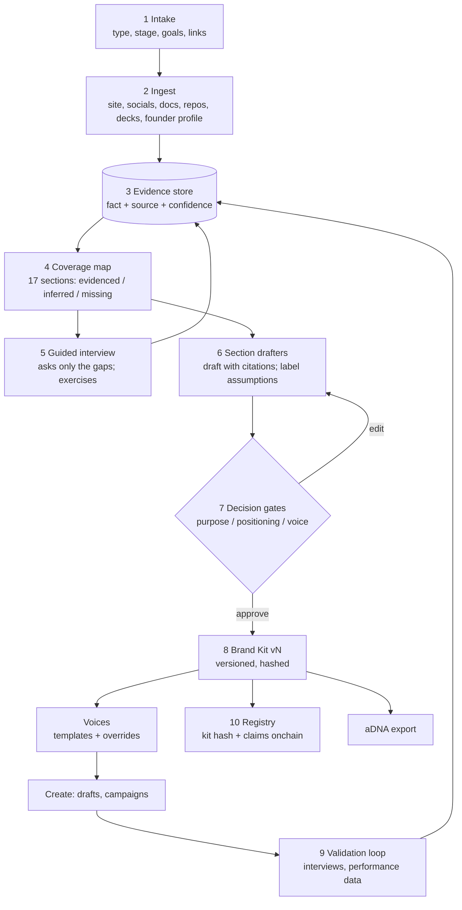
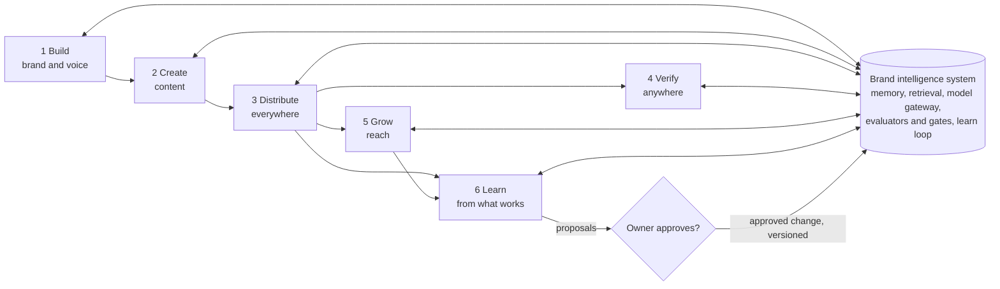
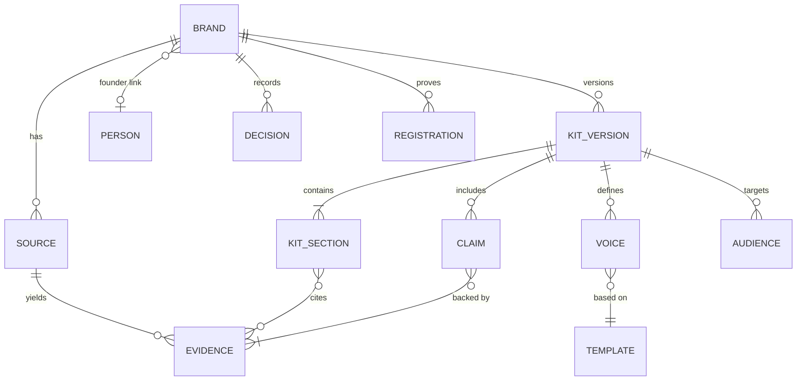

> **Status: accepted.** This is the Brand Builder architecture and input spec. Ratified by Ally Haire in chat, 2026-10-06. It feeds the PRD rewrite (issue #2), and the build follows the phased plan in [issue #4](https://github.com/DeveloperAlly/solana-hack/issues/4). §2a (six stages on one intelligence system, 2026-10-13) is proposed and awaits the owner's ratification of [ADR-012](../decisions/adr_012_six_stages_one_intelligence_system.md).

# Brand Builder: architecture and input spec

**Builds on:** [01 brand pillars](./research/01_brand_pillars.md) (9-step workflow), [02 brand voice elements](./research/02_brand_voice_elements.md) (17-section Brand Kit), [06 voice templates](./research/06_voice_templates.md), [09 demo brands](./research/09_demo_brands.md), [ADR-003](../decisions/adr_003_superhub_business_model.md).

## 1. Design principles
1. **Infer first, then ask only about the gaps.** The product reads what's public, then interviews the owner about what's missing. A brand with no presence is mostly interview. A semi-established brand is mostly confirmation.
2. **Maturity is measured per section, not per brand.** aDNA has a rich written brand but no social presence ([09](./research/09_demo_brands.md)). The builder scores each of the 17 sections separately, so it never asks a question the sources already answer.
3. **Every fact keeps its source.** Every extracted or answered fact is stored as **evidence** with a source: a URL, a document, or "owner answer, date". Drafts cite evidence, and nothing is stated without it. This is the founder's brand-database rule, and it is what gets registered onchain.
4. **The AI drafts and the human decides.** Three **decision gates** (purpose, positioning, voice) must be approved before anything downstream is generated. Inferred personas are labelled as assumptions until real people validate them ([01](./research/01_brand_pillars.md)).
5. **Choose by example, not by adjective.** Voice and tone are picked from sample copy at different slider settings, never from a list of adjectives.
6. **Separate what we say from how we say it.** Strategy (purpose, positioning, messaging) is stored separately from voice (attributes, tone presets, vocabulary). The voice tools reviewed in research 02 merge the two.
7. **The kit is versioned and portable.** Each approved kit version is hashed and exportable as aDNA-structured context. Only approved versions are registered onchain.

## 2. Pipeline



| # | Stage | Input | Output | Agent / owner |
|---|---|---|---|---|
| 1 | Intake | Short form (§5) | Brand profile, type, goals, source list | Owner |
| 2 | Ingest | URLs, uploads, connected accounts | Raw documents | **Ingestor:** fetches, parses, dedupes; respects robots.txt and platform terms; no scraping of private profiles |
| 3 | Evidence store | Raw documents and answers | `Evidence` rows (fact, quote, source, date, confidence) | **Extractor:** maps text to Brand Kit fields |
| 4 | Coverage map | Evidence | A state per section: E / I / M | **Gap analyst:** rules from the input spec (§4) |
| 5 | Guided interview | Gaps only | Owner answers, which become evidence | **Interviewer:** picks the next best question; exercises; skippable |
| 6 | Section drafters | Evidence | Section drafts with citations | **Drafters**, one per section group; **Critic** runs the no-AI-slop pass and consistency checks |
| 7 | Decision gates | Drafts | Approved sections | Owner (human) |
| 8 | Brand Kit | Approved sections | Kit vN plus hash | System |
| 9 | Validation loop | Interviews, post performance | New evidence, suggested kit updates | **Analyst** (later) |
| 10 | Registry | Kit hash, claims, accounts, content | Onchain memos | **Registrar** (deterministic code) |

## 2a. System architecture: six stages on one intelligence system [proposed 2026-10-13]

**Owner's definition (2026-10-13, working session):** the complete system is six stages: (1) build your brand and voice, using the intelligence system; (2) create your content, with an intelligence system made for your brand and voice; (3) distribute everywhere, to all the platforms; (4) verify anywhere, through the ledger; (5) grow your reach (ambassadors, influencers, campaigns), also on the intelligence system; (6) learn from what works (analytics and self-learning), also an intelligence system. Her rulings: "the spec should account for this; doesn't mean it gets built now; features get built by demand or market need", and the architecture must be "fully composable, scalable and maintainable". The README already opens with the six steps ([README, The system](../../../README.md#the-system)). The decision to organise the spec this way is [ADR-012](../decisions/adr_012_six_stages_one_intelligence_system.md) (proposed).

**What this section fixes.** Before it, the parts of the intelligence system were specified as separate features in separate places: the evidence store (§3, backlog B3), the voice ladder (§6.2), learned rules (§6.1, T1b), the validation loop (§2 stage 9, §12.3 rule 6, B16), analytics (backlog N1 to N4) and the evaluators (§6.1, §13). Each stage reached into its own part directly; in the code, drafting reads kit sections itself and the claims check reads all evidence in batches (`voiceContext`, `allEvidence` and `policyCheck` in [`posts.ts`](../../../web/worker/posts.ts)). Distribution stopped at five platforms (§6.1 Publishing row; [backend map §10.5](./backend_map.md#105-publishing-order-p2-p3-p3a)). This section makes the intelligence system one named engine that every stage reads from and writes to, and makes distribution an adapter registry that accounts for every platform. It renames nothing that already exists: every part below keeps its backlog ID.



### 2a.1 The six stages

Backlog IDs are the [backlog](../../how/backlog/backlog.md) rows; a range such as "B1 to B17" includes the lettered rows inside it (B2a, B3a, B8a). Status is the backlog's "On main at 9da167b" column, a dated baseline; live status is only in [STATE.md](../../../STATE.md).

| # | Stage | Backlog IDs | On main at 9da167b |
|---|---|---|---|
| 1 | **Build your brand and voice** | A1 to A7, B1 to B17, K1 to K7, V1, V1a, V2, V4, V5 | Built: A2, A3, A3a, B1, B3, B9, B10. Partial: A1, B2, B6, B8, B17, K3, V1. The rest is spec |
| 2 | **Create your content** | T1 to T10, M1 to M10, G1 to G4, C1 to C3, V1b, V3 | Built: T2, G1, G3, V3. Partial: T1, C1, G2. The rest is spec |
| 3 | **Distribute everywhere** | P1 to P19, S4 | Built: P1 (copy, publish yourself, paste the link back). The rest is spec; P7 to P19 are new in this section |
| 4 | **Verify anywhere** | L1 to L12 | Built: L2, L3. Partial: L1, L4. The rest is spec |
| 5 | **Grow your reach** | R1 to R11, I1 | All spec; R11 is new in this section |
| 6 | **Learn from what works** | N1 to N5 (B16 is Build's consumer of the loop) | All spec; N5 is new in this section |
| All | Shared engine and settings | X1 to X18, S1 to S3, S5, S6 | Built: X7, X9, X13, S1. Partial: X1, X6, X8. The rest is spec; X18 is new in this section |

Every stage is accounted for in the spec. What gets built, and when, is decided by demand or market need (owner, 2026-10-13); the phase each row sits in, or the "By demand" list, is in [backlog §15](../../how/backlog/backlog.md#15-build-order).

### 2a.2 The brand intelligence system (backlog X18)

One engine per brand. It holds everything JamJam knows about the brand and every judgement made about it, and it is the only way a stage reads or writes that knowledge. Its parts already exist in the spec under their own IDs; X18 is the shared contract that joins them.

| Part | What it holds or does | Backlog IDs | On main today |
|---|---|---|---|
| **Brand memory: evidence** | Facts with a verbatim quote, source, trust class and owner review decision | B3, B3a, X7 | Built: quote check ([`quote.ts`](../../../web/worker/quote.ts)), trust classes and the allow-list ([`sources/registry.ts`](../../../web/worker/sources/registry.ts), [ADR-011](../decisions/adr_011_evidence_trust.md)) |
| **Brand memory: kit versions** | Approved sections, canonical JSON hash, version number | B9, B10, B17 | Built (`canonical()` in [`kit.ts`](../../../web/worker/kit.ts)) |
| **Brand memory: voice** | Template and dials, voice-by-example picks, voice pack samples with their source path, the extracted voice spec | V1, V1a, V2, V4 | Partial (12 templates, 8 dials and claims level; §6.2 rung 0) |
| **Brand memory: claims** | Claim text, evidence ids, owner, expiry | C1 | Partial (claims level and per-post check; claim table not built) |
| **Brand memory: learned rules** | Readable rules learned from edits, each kept or deleted by the brand | T1b | Spec |
| **Brand memory: decision history** | Gate decisions; approve, reject with a reason code, and edits as original and final; all candidates with their scores; retrieved exemplar ids and spec version (§6.2 "Collect from day one") | B9, G3, T1b | Partial: gate and post approvals are recorded and a post keeps its last 10 versions (`pushHistory` in [`posts.ts`](../../../web/worker/posts.ts)); reject reasons, candidates and exemplar ids are not stored |
| **Brand memory: outcomes** | Metric snapshots (appended, never overwritten), the outcome log and attribution, campaign and submission results | N1 to N3a, R3b | Spec (`metrics` table stub in [`spec/api/schema.sql`](../../../spec/api/schema.sql)) |
| **Retrieval** | Approved posts and site excerpts by topic and by style, filtered by the evidence allow-list before similarity | X16 | Spec (the allow-list filter it uses is built: `USABLE_FILTER` in `sources/registry.ts`) |
| **Model gateway and model choice** | One call path for every prompt; default `openrouter/free`, then the brand's own key, then a self-hosted provider ([ADR-010](../decisions/adr_010_component_list_and_plan_tiers.md) decision 6); versioned prompts and traces | X1, X2, X3, X5, X14, S2 | Partial ([`llm.ts`](../../../web/worker/llm.ts): one gateway, default `openrouter/free`, retries) |
| **Evaluators and gates** | No-AI-slop, claims, content policy, brand gate, independent review, measured voice and platform scorers, media checks, drift, the evaluation harness | G1, G2, G4, V3, T1a, M9, K6, X8, X12 | Partial (`slopCheck` and `policyCheck` in `posts.ts`) |
| **Learning loop** | Turns outcomes into proposals for each stage; the owner decides (§2a.3) | N5, with B16, T1b and R11 as its consumers | Spec |

**What each stage reads and writes.** A stage never reads another stage's tables; it asks the engine.

| Stage | Reads from the engine | Writes to the engine |
|---|---|---|
| 1 Build | Usable evidence and owner answers; templates; prior kit versions; approved kit-update proposals (B16) | Sources; facts with quotes, trust and review status; owner answers; section drafts with fact ids; gate decisions; kit versions; voice spec and samples |
| 2 Create | The registered kit version; voice spec; retrieved exemplars; learned rules; usable facts and claims; channel specs (K3) | Every candidate with its scores; drafts; edits as original and final; reject reasons; evaluator verdicts; approvals |
| 3 Distribute | The approved post and its approved hash; each platform adapter's declared capabilities; approved timing and format proposals | Publish records: platform, post id, URL, published hash, disclosure flags set, failures (P5a) |
| 4 Verify | Registrations and approved hashes | Registrations (L1, L2); retractions (L8); impersonation reports (L3a) |
| 5 Grow | Kit and voice; campaign history; outcomes; approved campaign proposals (R11) | Campaigns; submissions and their check results (R3b); payout records (R3c); campaign results |
| 6 Learn | Every outcome, approval, edit and reject reason | Metric snapshots (N2 rules); proposals; the owner's decision on each; applied changes with a version |

**Invariants.** Each is a check, not a sentence (backlog §13).

1. **Human approval on everything.** Nothing posts, replies, sends or pays without a person approving it ([ADR-003](../decisions/adr_003_superhub_business_model.md) principle 1).
2. **Nothing grades itself.** A generator's output is judged only by a check it cannot influence: code, or a model from a different family with fresh context (§6.1; backlog G4; §13.3).
3. **Only quoted facts are evidence.** A fact enters memory only when its quote is on its source, and only allow-listed facts reach drafting, the kit, the claims gate or registration (§1 principle 3; [ADR-011](../decisions/adr_011_evidence_trust.md)).
4. **The owner approves every learned change.** Learned rules are shown to the brand to keep or delete (T1b); kit updates go back through the gates and produce a new kit version (§12.3 rule 6); no record leaves UNVERIFIED unless the owner promotes it (backlog §13).
5. **One brand's memory never shapes another brand's output.** Retrieval and learned rules are scoped to one brand. The only pooled use is the later global anti-slop and preference pass, and only with each brand's training consent (§6.2).

### 2a.3 The learn loop (backlog N5)

Outcomes flow back into every stage as **proposals**. A proposal is a record: brand, target stage, kind, the change, the outcome ids it rests on, the result of its evaluation, and a status (`proposed`, `approved`, `rejected`) with who decided and when. Nothing changes until the owner approves it.

| Signal (written by) | Feeds | Proposal kinds | What applying it does |
|---|---|---|---|
| Customer interviews, post performance, new evidence (Learn, Build) | **Build** | Kit update suggestions: a section to redraft, a messaging pillar to demote, a new evidenced fact (B16) | Redraft goes back through the gates and creates a new kit version, registered as usual (§12.3 rules 2 and 6) |
| Edits, approvals without edit, reject reasons (Create) | **Create** | Learned rules from edits (T1b); exemplar ranking that favours approved posts which performed; later a brand-style reranker (§6.2 rung 2) | The rule or ranking is stored with a version; the next draft retrieves it; the brand can delete it |
| Metric snapshots per platform and format (Learn, via adapters) | **Distribute** | Posting windows per platform (best times are local-time windows to test, [research 03](./research/03_platform_performance.md)); format per platform, for example a carousel instead of text on LinkedIn ([research 11](./research/11_media_formats.md) §1a) | The schedule default or format suggestion changes for that brand and platform |
| Campaign and submission results (Grow) | **Grow** | Self-learning campaigns (R11): audience, format and budget split adjustments within the capped budget | The campaign plan changes; payouts still need the owner's own signature (R3c, [ADR-006](../decisions/adr_006_wallet_identity_split.md)); no X activity is ever rewarded (backlog §13) |

**Rules for every proposal.**

1. **Cites its outcomes.** A proposal lists the outcome ids it rests on, the outcome counterpart of the quote rule. Metrics follow backlog N2: rates over impressions, never raw counts, and the first 90 days shown as calibration.
2. **Judged by something else.** A proposal is evaluated by a check other than the model that wrote it: the harness on fixtures, or a held-out comparison on production signals (§13.4). The minimum sample before a proposal is offered is set from harness data; no threshold is chosen yet (UNVERIFIED).
3. **Owner approves.** Shown with its evidence and expected effect; approve, reject (with a reason) or edit.
4. **Versioned and reversible.** An applied change records who approved it and when, and can be rolled back. A change that lowers approval without edit is rolled back (§13.4).
5. **Never acts on its own.** A proposal changes a plan, a rule or a default. It never publishes, replies, or moves money.

### 2a.4 Distribute everywhere (backlog P7 to P19)

**One adapter per platform, one registry for all of them (P7).** Distribute never calls a platform directly. Each platform is an adapter that declares what it can do, and the registry refuses a publish the adapter does not declare. The copy-and-paste path (P1) is the manual adapter and works for any network.

```ts
// Contract only (proposed). No Cloudflare or Supabase code inside an adapter.
interface DistributionAdapter {
  id: string;                     // 'x', 'linkedin_member', 'bluesky', 'manual', ...
  version: string;
  capabilities: { formats: ('text' | 'thread' | 'image' | 'carousel' | 'document' | 'video' | 'article' | 'email')[];
                  limits: Record<string, number>;   // characters, images, video seconds, posts per day
                  schedule: 'native' | 'jamjam'; edit: boolean; remove: boolean };
  auth: { kind: 'oauth2_pkce' | 'oauth2' | 'app_password' | 'bot_token' | 'api_key' | 'webhook' | 'smtp' | 'none';
          scopes: string[]; access: 'self_serve' | 'app_review' | 'vetted' | 'unverified'; tokenLifetime?: string };
  cost: { perPost?: number; perPostWithLink?: number; currency: 'USD' } | null;
  disclosure: { aiFlag?: string; paidPartnershipFlag?: string; readsC2pa: boolean | 'unverified' };
  check(post: ApprovedPost): Violation[];          // format limits, from the channel spec (K3)
  publish(post: ApprovedPost, creds: Credentials): Promise<{ platformPostId: string; url: string; publishedHash: string }>;
  readMetrics?(platformPostId: string, creds: Credentials): Promise<MetricSnapshot[]>;   // optional
}
```

Rules: the published text must hash to the approved hash 100% of the time (§6.1 Publishing row); disclosure flags are pre-filled from the asset's generation record (backlog P5); tokens are encrypted at rest per brand (backlog X11, G-SECRETS); a platform's cost is shown before posting (backlog P2, G-X-COST); a failed publish alerts (P5a).

**Every platform is accounted for in the spec; which are built is decided by demand.** The table carries only what the repo's research already says; anything else is marked UNVERIFIED and is checked against the platform's own docs before its row is built.

| Platform | Row | Access model and API (repo evidence) | Metrics read-back | AI disclosure | Source |
|---|---|---|---|---|---|
| Any network (manual) | P1 | Copy, publish yourself, paste the link back | None | The brand sets it on the platform | backlog P1 |
| X | P2 | OAuth 2.0 PKCE; `POST /2/tweets`; $0.015 a post, $0.20 with a link; never a paid ambassador route | `public_metrics` for the brand's own posts; read pricing TO VERIFY | `made_with_ai` and `paid_partnership` on create post per backend map §9; research 11 says whether the API exposes the toggle is UNVERIFIED (sources disagree) | [backend map §9](./backend_map.md#9-external-api-facts-verified-2026-10-06-primary-docs), [research 11](./research/11_media_formats.md) §4a |
| LinkedIn (member) | P3 | Self-serve `w_member_social`; 60-day tokens, no refresh; Documents API for carousels (100 MB, 300 pages) | Needs Community Management API approval | No self-disclosure rule found; shows a C2PA icon | backend map §2, §9; research 11 §1b, §4a |
| LinkedIn (Company Page) | P3a | Vetted Community Management API; needs a legal entity and a screencast | Same approval | As above | [backend map §10.1](./backend_map.md#101-decisions) item 6 |
| Bluesky | P3a | Free, open API; rate limits apply; 4 images, video up to 10 min | UNVERIFIED | No AI rule found | backend map §10.5; [research 03](./research/03_platform_performance.md); research 11 §1b |
| Threads | P3a | App review; 5 links and 250 posts per 24 h; carousels of 2 to 20 | UNVERIFIED | Meta "AI info" labels from C2PA or self-disclosure | backend map §10.5; research 03; research 11 §1b, §4a |
| Instagram | P8 | Graph API content publishing; carousels up to 10 items by API; Reels 3 s to 15 min; 50 or 100 posts per 24 h (Meta pages conflict); account and review requirements UNVERIFIED | UNVERIFIED | Meta disclosure rules; reads C2PA | research 11 §1b, §4a; [research 04](./research/04_brand_hub_landscape.md) §4 |
| Facebook (Pages) | P9 | Publishing API UNVERIFIED in this repo; competitors publish there (Hootsuite, Pressmaster); comment replies need `pages_manage_engagement` | UNVERIFIED | Meta disclosure rules | research 04 §4; [research 10 B](./research/10_competitor_detail/b_ai_social_voice.md), [10 C](./research/10_competitor_detail/c_social_ops.md); research 11 §4a |
| TikTok | P10 | Content Posting API: photo posts up to 35 images; video up to 10 min, 4 GB; 5 pending uploads per user per 24 h; app audit requirements UNVERIFIED | Display API covers the user's own videos | `is_aigc` flag; reads and attaches C2PA | research 11 §1b, §4a; backend map §9 |
| YouTube (incl. Shorts) | P11 | Upload API UNVERIFIED in this repo; Shorts up to 3 min | `videos.list` statistics, 1 quota unit | Realistic synthetic content must be disclosed; API field UNVERIFIED | backend map §9; research 11 §1a, §4a, open questions |
| Farcaster | P12 | Publishing API UNVERIFIED; the repo covers only Farcaster account verification badges | UNVERIFIED | UNVERIFIED | [research 10 F](./research/10_competitor_detail/f_provenance.md) |
| Telegram (channels) | P13 | Channel posting UNVERIFIED; the repo covers Telegram for the inbox only (bot, or an MTProto client) | UNVERIFIED | UNVERIFIED | [compendium §7](./compendium_2026_10_06.md#7-unified-inbox-coming-soon); backend map §4 |
| Discord | P14 | Bots only (inbox research); channel posting by bot or webhook UNVERIFIED | UNVERIFIED | UNVERIFIED | compendium §7 |
| Reddit | P15 | API access and terms UNVERIFIED; Reddit blocked automated fetching during research; posting only from the brand's own account, draft and approve (purchased-account tools are the anti-pattern) | UNVERIFIED | UNVERIFIED | research 04 |
| Long-form: Medium, Substack, Ghost, beehiiv, WordPress, own blog (RSS or API) | P16 | Competitors connect WordPress, Ghost and Medium (Pressmaster) and Substack Notes (Typefully); Ghost by webhook or API (Encypher); each API's terms UNVERIFIED; RSS as the read-back for an own blog | RSS for what was published; engagement UNVERIFIED | Blog rules: byline, disclose how it was made, including AI | research 10 B, 10 F, [10 D](./research/10_competitor_detail/d_ambassador_payouts.md); research 03 (Blogs and SEO); §6 Beautify (Markdown for blogs) |
| Newsletter (email) | P17 | Resend is already the sender; needs the owned audience list with consent (R10); Gmail and Yahoo sender rules: SPF, DKIM, DMARC, one-click unsubscribe, complaints under 0.3% | Provider events UNVERIFIED | UNVERIFIED | backlog R10; research 03 (Substack and newsletters) |
| Mastodon | P18 | A competitor schedules to Mastodon (Typefully); API and terms UNVERIFIED | UNVERIFIED | UNVERIFIED | [issue #82](https://github.com/DeveloperAlly/solana-hack/issues/82) (platforms page); research 10 B |
| Developer: GitHub, dev.to | P19 | UNVERIFIED | UNVERIFIED | UNVERIFIED | issue #82 |

A platform not in this table (for example Pinterest or WhatsApp channels, both UNVERIFIED) is one adapter and one backlog row; no stage code changes. Issue #82's platforms page is the screen view of this registry.

### 2a.5 Composable, scalable, maintainable

**Module boundaries.** [Backend map §10.3](./backend_map.md#103-reuse-providers-and-packaging) already decides that each component becomes a package with a typed contract and no Cloudflare or Supabase code inside, with the Worker only wiring packages together, and lists ten modules (provider client, normaliser, evidence extraction, slop scorer, claims checker, voice, eval harness, registrar client, payout builder, Verify matcher). The media modules are in [research 11 detail §8](./research/11_media_detail/generation_stack.md#8-reusable-modules-and-typed-contracts). This section adds the modules the six stages need and §10.3 does not list:

| Module | Contract | Reuses | Backlog |
|---|---|---|---|
| Brand memory | `read(brandId, query)` returns typed records with provenance (source, quote, version, decider); `write(brandId, record)` returns id and version; outcomes and decisions are append-only | The evidence allow-list (`sources/registry.ts`); a storage port the Worker implements on Supabase | X18 |
| Learn loop | `propose(brandId, outcomes)` returns proposals with the outcome ids they rest on; `decide(proposalId, decision, by)` applies a versioned change or none | Eval harness (§10.3); brand memory | N5 |
| Campaign optimiser | `adjust(campaign, outcomes, budgetCap)` returns proposed audience, format and budget-split changes, never a payment | Learn loop; payout builder (§10.3) | R11 |
| Distribution adapter registry | `register(adapter)`, `get(platformId)`, `list(capabilityFilter)`; the adapter contract in §2a.4 | Channel specs (K3); secrets vault (X11) | P7 |
| Analytics ingest | `ingest(adapter, platformPostId)` returns appended metric snapshots with unit and denominator | Adapter `readMetrics`; metric rules (N2) | N1 |
| Evaluator registry | `register(evaluator)` with id, version, kind (gate or score) and model family; `run(input)` returns a verdict with findings | Slop scorer and claims checker (§10.3); harness (X12) | G1, G2, G4, T1a |

**Where the code is today, and where each piece goes.** On main the logic lives in Worker files, not packages; only the source registry ([`sources/registry.ts`](../../../web/worker/sources/registry.ts)) is already a registry. Open PRs move in this direction: source adapters under `web/worker/sources/` ([PR #71](https://github.com/DeveloperAlly/solana-hack/pull/71)) and the workflow engine under `web/worker/engine/` ([PR #70](https://github.com/DeveloperAlly/solana-hack/pull/70)); neither is on main.

| File on main | What it holds now | Target modules |
|---|---|---|
| [`llm.ts`](../../../web/worker/llm.ts) | Gateway (`chat`), JSON parsing, the slop rule text | Provider client (§10.3); slop rules move to the slop scorer |
| [`ingest.ts`](../../../web/worker/ingest.ts), [`sources/registry.ts`](../../../web/worker/sources/registry.ts), [`quote.ts`](../../../web/worker/quote.ts) | Page reading, source kinds and trust, quote check | Source adapters (X6); normaliser; evidence extraction; brand memory writes |
| [`kit.ts`](../../../web/worker/kit.ts) | Sections, gates, steps, canonical JSON | Build stage; kit versions in brand memory |
| [`api.ts`](../../../web/worker/api.ts) | Routes plus section drafting, ingest, kit registration, answers, evidence review | Worker wiring only; drafting to Build, registration to Verify, reads and writes through brand memory |
| [`posts.ts`](../../../web/worker/posts.ts) | Drafting, slop check, polish, claims and content policy, approval, registration, Verify and Ledger | Create (drafting, polish); evaluator registry (slop, policy); Verify (register, verify, ledger) |
| [`registry.ts`](../../../web/worker/registry.ts) | SAS attestation | Registrar client (§10.3) |

Extraction happens when a file is next changed for a feature, one module per PR, behaviour unchanged and covered by a contract test; there is no separate rewrite (proposed in ADR-012).

**Extension points.** Each is a registry: adding an entry is one file plus a test plus a backlog row, and no stage code changes.

- **Sources:** source kinds and their trust class (built: `SOURCE_TYPES` in `sources/registry.ts`; backlog X6).
- **Distribution platforms:** adapters (P7; §2a.4).
- **Media renderers:** templates and generators (X10; research 11 detail §8 `brand-render`, `motion-render`, `media-gen`).
- **Evaluators:** gates and scorers, each with a model family so the "nothing grades itself" check is mechanical (G1, G2, G4, T1a, M9).
- **Model providers:** the brand's key, a self-hosted endpoint, the default router (X1 to X3; backend map §10.2).
- **Proposal kinds:** what the learn loop may suggest, per stage (N5).

**Multi-tenant scaling.**

- **Per-brand isolation.** Every memory row carries `brand_id`; only the Worker reads and writes (RLS on with no policies, [README Architecture](../../../README.md#architecture)); role checks per route when seats arrive (A6, `requireRole` stub); retrieval filters by brand before similarity (invariant 5).
- **Long jobs.** Ingest, drafting, rendering, publishing with retries, metric polling and learn runs are durable workflow runs (X4), one step per external call, because the Free plan allows 10 ms CPU per step and 1 MiB per step result ([backend map §2](./backend_map.md#2-runtime-topology-proposed)).
- **Rate limits.** Per brand (X15); per platform, as each adapter declares (for example Threads 250 posts a day, TikTok 5 pending uploads); per model route (OpenRouter free: 20 requests a minute, and 50 or 1,000 a day; backend map §2 and §6.2). A brand that brings its own key carries its own model usage (S2).
- **Data growth.** Outcomes and decisions are append-only (N2), so they grow fastest; full source text is stored for the quote check (migration 008); embeddings live in Postgres vectors (X16). Partitioning or roll-ups by brand and month, and a retention policy for source text, are deferred until volume needs them.

**Decided now and deferred.**

| Decided by this section (once ADR-012 is ratified) | Deferred, built by demand |
|---|---|
| Six stages are the top-level structure of the spec and the backlog | Which stages and platforms are built next, and when |
| One brand intelligence system (X18) with the five invariants in §2a.2 | Storage layout inside brand memory beyond today's tables; partitioning and retention |
| Every learned change is an owner-approved, versioned proposal (N5) | Proposal thresholds (minimum sample) and the reranker (§6.2 rung 2) |
| One adapter contract and registry for distribution (P7); every listed platform has a row | Each platform adapter (P8 to P19), after its UNVERIFIED access facts are checked |
| New modules are packages behind typed contracts, extracted on touch | Moving the Worker to a separate pipeline Worker (backend map §2), and the paid Workers tier |

## 3. Data model



- **Brand:** id, name, type (company / person / product), stage, domain, verified (DNS), parent and founder links.
- **Person:** a founder or person profile with its own kit. It shares the story bank with a linked company.
- **Source:** url or upload, kind (site, doc, social, repo, deck, profile, interview), fetched_at, owner_supplied.
- **Evidence:** fact, verbatim quote (short), source_id, section, confidence (high / med / low), status (evidenced / inferred / answered / rejected).
- **Kit version / Kit section:** section key (one of the 17), content JSON, state (E / I / M), approved_by, approved_at, hash.
- **Claim:** text, evidence ids, owner, expiry, status (approved / pending / expired), registered_tx.
- **Voice:** template id plus overrides (9 dimensions, per-channel), example outputs, approved.
- **Audience:** segment, jobs, pains, gains, channels, expertise, validation status (proto / validated).
- **Decision:** gate, choice, rationale, by, at. It mirrors an ADR.
- **Registration:** type (identity / account / content / claim / kit / persona), hash, tx signature, at.

## 4. Input spec (per Brand Kit section)

Key: **Req** = needed before kit v1 · **Infer from** = where the builder looks first · **Ask** = the question when not evidenced · **Ex** = exercise · **min** = owner time · **Zero-data fallback** = what happens when nothing is public · **Gate** = needs explicit approval.

| # | Section | Req | Infer from | Ask (only if missing) | Ex | min | Zero-data fallback | Gate |
|---|---|---|---|---|---|---|---|---|
| 1 | Identity | Yes | Domain, site title, socials, org pages | Name, type (company / person / founder-linked), one-line description | Form | 1 | Ask | |
| 2 | Purpose | Yes | About / mission pages, founder talks, README | "Why does this exist? What was broken?" "What will it do in 5/10/20 years?" | Golden Circle prompts (What / How / Why) | 3 | Draft from origin-story answers | **Purpose** |
| 3 | Beliefs / POV | Yes | Long-form posts, manifestos, changelogs | "What do you believe that most of your category doesn't?" "What are you against?" | This-not-that pairs | 2 | Draft from purpose plus competitors | |
| 4 | Values | Yes | Values pages, hiring pages | Pick and rank 3 values from cards; "what cost would you accept for each?" | Value card sort | 2 | Ask | |
| 5 | Positioning | Yes | Site hero, comparison pages, competitor sites (public) | "What would people use if you didn't exist?" "What can you do that they can't?" | Dunford sequence; 2x2 | 3 | AI researches competitors and drafts options | **Positioning** |
| 6 | Value props | Yes | Feature and benefit copy, pricing pages | Confirm or edit the drafted jobs, pains and gains per segment | Value Proposition Canvas (prefilled) | 2 | Draft from positioning | |
| 7 | Audience | Yes | Site copy, community pages, follower bios (aggregate only) | "Whose opinion do you care about?" Name 1–3 real customers or fans | Persona cards | 2 | Proto personas, **labelled as assumptions** | |
| 8 | Messaging | Yes | Taglines, headings, repeated phrases | Rank the drafted pillars; mark must-keep phrases | Card sort: is / aspires to be / is not | 2 | Draft from 2–7 | |
| 9 | Voice attributes | Yes | Corpus profiling (needs 300–500+ words per research 02) | Choose between sample paragraphs written at different settings | Pick by example | 2 | Samples generated from the archetype plus sliders | **Voice** |
| 10 | Tone presets | Yes | Per-channel corpus (if any) | Set presets per channel and context, starting from templates (research 06) | Sliders on 9 dimensions | 2 | Template defaults | (in Voice gate) |
| 11 | Vocabulary | No | Term frequency in sources; product names | Confirm approved and banned terms | List edit | 1 | Seed from positioning plus category | |
| 12 | Claims | Yes (for proof layer) | Numbers and superlatives in sources | Attach evidence or downgrade each claim | Claim table | 2 | Only claims with owner-supplied evidence | |
| 13 | Visual kit | No | Logo files, CSS colours and fonts, OG images | Upload logo, pick colours and type | Upload / pick | 2 | Placeholder, or hand off to a design tool | |
| 14 | Audio kit | No | Media files | Sonic logo or voice persona (optional) | Upload | 0 | Skip | |
| 15 | Behaviour | No | Support pages, changelog tone | How to apologise, celebrate, handle conflict | Short scenarios | 1 | Template defaults | |
| 16 | Examples | No | Existing posts | Mark on-brand and off-brand examples | Thumbs up / down | 1 | Generated examples (labelled) | |
| 17 | Governance | Yes | n/a | Owner, approvers, review cadence | Form | 1 | Owner = creator | |

**Totals:** all sections from zero comes to about **30 minutes** of owner time. With the minimum viable intake below, about **15 minutes** gets kit v1.

## 5. Minimum viable intake (zero-presence brand, ~15 min)
This is the shortest path to a usable kit v1. Everything else starts as a labelled draft and is refined later.
1. **Form (2 min):** name, type, one-line description, links (if any), 12-month goal, primary channel.
2. **Origin (3 min, voice or text):** why it exists; what was broken; first win or proof point.
3. **Golden Circle (2 min):** what / how / why. The AI drafts purpose for **Gate 1**.
4. **Alternatives and edge (3 min):** what people use instead; what only you can do. The AI researches competitors and drafts 3 positioning options for **Gate 2**.
5. **Audience (2 min):** whose opinion matters, and 1–3 real people if any. The AI drafts proto personas.
6. **Voice by example (3 min):** pick 1 of 3 paragraphs, twice; adjust 3 sliders. Then **Gate 3**.

Beliefs, values, messaging and vocabulary are then drafted from these answers and shown for quick edits. Claims start empty until evidence is attached.

## 6. Voices and polish
- **Voices** are a template (research 06) plus per-channel overrides on 9 dimensions. Claims strictness works as a gate, not a slider. A kit can hold several voices, e.g. Founder / Candid and Brand / Professional.
- **Draft pipeline:** brief → draft in the chosen voice → no-AI-slop pass → voice-fit score + platform score (research 03) → **polish actions** → human approval → schedule or post → optional registration.
- **Polish actions** (on any draft, single click, always reversible):
  - **Review:** flags clarity, factual claims without evidence, off-voice phrases, and platform issues. LinkedIn's own composer offers Review, Shorten and Clarify, and its Post Proofreader (Premium, Aug 2026) suggests inline fixes ([SocialPilot](https://www.socialpilot.co/blog/new-linkedin-features-and-updates)).
  - **Shorten:** to platform norms or a target length.
  - **Clarify:** simplifies sentences and jargon to the voice's targets.
  - **Beautify (new):** structure for scanning.
    - Turns lists into bullets (e.g. "•").
    - Adds a hook line and spacing between blocks.
    - Promotes key phrases.
    - Applies per-platform formatting: markdown for Substack and blogs, plain text with line breaks for LinkedIn and X.
    - LinkedIn has **no native bold**, so emphasis needs Unicode "mathematical" characters. Screen readers may read these letter by letter, so Beautify limits Unicode emphasis to a few key phrases and offers an **accessible mode** that uses no Unicode styling ([linkedinpreview](https://linkedinpreview.com/blog/linkedin-unicode-formatting-guide)).

### 6.1 Component design and evaluation [accepted 2026-10-12]

Moved here from the 2026-10-12 delivery plan so the repo holds it. Each component has its state on main (9da167b), the option chosen for the best output with the alternatives it beat, and the measure that proves it. IDs are the [backlog](../../how/backlog/backlog.md) IDs. A component is done only when its measure passes on the fixtures in §13. The rule throughout: **nothing grades itself.** Today the drafting prompt scores its own voice fit and platform fit (`posts.ts` `draftPost`); every measure below replaces that with a check the generator cannot influence. Sources: §13.5.

**System map.** Every component reads from or writes to one evidence store, and nothing reaches Solana unless a person approved it. Read top to bottom: a person acts in a surface, which starts a durable run (backlog X4, #32); runs call agents through one LLM gateway (X1); agents read and write evidence (§3); only approved records are hashed and attested (§7).

#### Intake and evidence (B2, B3, B4, B5, B6)

| Component | On main today | Best-output option (alternatives considered) | Measured by |
|---|---|---|---|
| **Source ingestion**: read what the brand already has | `ingest.ts` reads one URL; HTML entities decoded (#40) | Check robots.txt, then one Exa contents call for the home page plus about 8 key subpages (about $0.009 a brand; Exa's free monthly credit covers about 1,100 onboardings); fall back to a plain fetch, then Cloudflare's rendered Markdown for script-only sites, then paste. PDF, DOCX, XLSX via Workers AI `toMarkdown` (free); scanned PDFs through an OCR engine (about $2 per 1,000 pages); PPTX parsed in the browser. X and LinkedIn history from the owner's own data export, parsed in the browser. Rejected: single page (misses most facts), full-site crawl (cost, noise, free crawl limited to 5 jobs a day) | Key-page coverage ≥ 90% on the fixture sites; ≥ 95% of gold sentences present in the extracted text; cost and Worker CPU per brand logged |
| **Fact extraction with quote check** (B3) | Full source text stored and quotes checked with the shared normaliser (`quote.ts`, #40); one call, no enforced schema, default model `openrouter/free` | Chunks of 2–4k tokens with source offsets; strict JSON schema with the provider required to honour it; both sides normalised (Unicode, quote marks, dashes, entities) and an exact match required; a fuzzy match (≥ 0.9) used only to find the real passage, after which the stored quote is replaced by the exact source text and its offsets (the source-alignment design in Google's LangExtract); a second check that the quote actually supports the fact; overlapping facts merged; contradictions turned into interview questions; confidence computed from match type and number of sources, not asked of the model. Rejected: one long call (models degrade as input grows), trusting the model's quote | **0 invented facts and 0 unsupported quote–fact pairs (hard gates)**; precision ≥ 95%, recall ≥ 70% against hand-labelled facts; false-drop rate of true quotes reported; 100% of planted near-miss quotes rejected |
| **Coverage map** (B4: Evidence, Inferred, Missing per field) | Not built (#34) | A coverage matrix of slots per kit section; ask only about missing, weak or conflicting slots, ranked by a simple stand-in for expected information gain. Evidence: prompting a model to ask questions made results worse, while asking only when unsure improved accuracy by 22% (MediQ). Rejected: static checklist (asks what the site already says) | Field-status accuracy ≥ 90% against gold; questions until full coverage; on aDNA ≥ 70% prefilled and < 5 min to kit v1 (#34) |
| **Guided interview** (B5, B6) | Linear steps (`steps.ts`) | Confirm mode: prefilled cards to accept, edit or reject, then gap questions only; answers stored as owner evidence so every fact follows the same quote rule. Rejected: a blank form (slow), free chat (hard to finish) | Time to kit v1; edits per prefilled field; 5-person usability run with ≥ 4 of 5 finishing unaided |

#### Brand kit (B8, B9, B10, B17, V1, V1a)

| Component | On main today | Best-output option (alternatives considered) | Measured by |
|---|---|---|---|
| **Kit drafting** (B8: purpose, positioning, audience, voice, origin, messaging) | Six sections (`kit.ts`) | One call per section, grounded on cited facts and interview answers; every sentence carries the fact ids it rests on; a critique pass flags generic or unsupported lines. Rejected: one prompt for the whole kit (generic, uncited) | ≥ 95% of kit sentences traceable to a fact or an answer; 0 slop hits; owner prefers it over an uncited baseline in ≥ 70% of blind pairs |
| **Voice capture** | 12 templates, 8 dials, one sample (`steps.ts`, `Build.tsx` L267–279) | Now: voice by example, pick 1 of 3 generated paragraphs, twice (architecture §5 step 6). Then: a voice spec extracted from the brand's own posts and stored as claims with quotes (see the voice question). Rejected: dials alone (people can't describe their own voice) | Blind test against held-out brand posts: the owner rates a generated post "sounds like us" ≥ 60% of the time; pairwise judge win rate against the dials-only version |
| **Gates and approval** (B9) | Three gates (`kit.ts`) | Keep; block registration until every section is approved; flag sections made stale by an edit (#31) | Automated test: an unapproved section can't be registered; an edit marks dependent sections stale |
| **Versioning and export** (B10, B17) | Canonical JSON hashing | Keep; add export | Same kit re-saved gives the same hash; export round-trips without loss |

#### Content creation (T1, T1a, T1b, G1, C1, T2, K3, G3, P2, P3)

| Component | On main today | Best-output option (alternatives considered) | Measured by |
|---|---|---|---|
| **Drafting engine** (T1, T1a) | One prompt; the model self-scores voice fit and platform fit 0–100 (`posts.ts` L81) | Retrieval of the brand's approved posts (3–5 by topic, 1–2 by style) plus the extracted voice spec plus learned rules, best of 3 candidates. Rejected for now: per-brand fine-tuning (needs deep data; see the voice question) | **North star: approved without edit.** Voice pass per brand: a draft must be at least as close to the brand (StyleDistance, plus a stylometric score in the Worker) as the brand's own least typical 10% of real posts. Ground truth: in a blind test of 40 pairs the owner picks the real post; 26 or more correct means the owner can tell, so passing is 25 or fewer. Pairwise judge win rate ≥ 60% against today's prompt |
| **Anti-slop pass** (G1) | Banned list in the prompt, one check and one rewrite (`llm.ts`, `posts.ts`) | Port the open-source EQ-Bench slop score into the Worker (overused words 60%, "not X, but Y" patterns 25%, overused three-word phrases 15%), add lexical diversity and a specificity rate, keep the ban list, and regenerate only the offending span; compare every draft with the brand's own human posts. Rejected: prompt-only bans (weak, can backfire); AI-text detectors (OpenAI's own caught 26% of AI text and was withdrawn); the backtracking sampler (needs logit access the hosted APIs don't give) | **0 ban-list hits and a slop score no worse than the brand's own posts (hard gate)**; < 5% false flags on the brand's human-written posts |
| **Claims gate** (C1, G2) | Policy verdict at approval only (`CLAIMS_POLICY`) | Split the draft into sentences and claims; each must cite a kept fact; rules for numbers, prices, superlatives and guarantees. In CI the reference checker is MiniCheck-Flan-T5-L (0.8B, MIT; 75.0 balanced accuracy on LLM-AggreFact, about 400× cheaper than GPT-4) with HHEM-2.1 (0.1B, Apache) as a second opinion; disagreements go to human review and become fixtures. At runtime the Worker's 128 MB can't host those models, so the gate is an LLM judge from a different model family than the drafter, given only the cited facts and calibrated on the fixture. Shown on the draft before Approve (T1a) | **Recall of unsupported claims ≥ 95%** (a false "supported" ships a false claim); precision reported, with human approval absorbing false alarms |
| **Polish actions** | Actions with undo (`posts.ts`) | Keep; re-run slop and claims after every polish | 0 new claims introduced by a polish; acceptance rate per action |
| **Platform fit** | Same self-score as above | Rename it "platform fit" and make it a rule-based lint per platform (length, first-line hook, link placement, hashtag count, mentions). Make no performance predictions: the best Twitter cascade model explained under half the variance (R² 0.48), and models picked the better of two controlled tweets only 66% of the time against people's 61%. Learn from real outcomes once posts publish | Lint pass 100%; later, correlation with real engagement |
| **Approval and learned rules** (G3, T1b) | Approve flow; edits not learned | Each edit becomes a readable rule (CIPHER) the brand can keep or delete; rules retrieved on the next draft | Edit distance falls over a brand's first 20 posts; share of learned rules kept |
| **Publishing** (P1 to P3, P3a) | Copy text, paste the URL back (`Create.tsx` L176) | Official APIs in order of cost and access: Bluesky (free), LinkedIn as a member (self-serve), X ($0.015 a post, $0.20 with a link, so links stay out of post bodies), Threads (app review), LinkedIn Company Pages (vetted access) | Publish success rate; the published text hashes to the approved hash 100% |

### 6.2 Voice: template first, then a ladder [accepted 2026-10-12]

**Owner ruling (2026-10-12):** the proof of concept starts from voice templates (research 06: 12 templates on 9 dimensions, claims strictness used as a gate). Existing open-source template sets are adopted where their licence and format fit; templates are authored only where none do. Each rung below is added when the evaluation harness (§13) shows it beats the rung before. Which open-source template sets are adopted, and which templates are authored, is in [research 06](./research/06_voice_templates.md) ("Reusable template sources"): templates must carry sample lines, because zero-shot style matching scored 3 to 7% in one 2025 study. The evidence for the rungs follows.

Above the template rung, the next step is retrieval plus a learned spec, not a fine-tuned model. Fine-tuning only beats retrieval once a brand has deep data, which JamJam's brands (10–200 posts) don't have yet. Collect the training data from day one so tuning is possible later. Evidence: on the LaMP benchmark, retrieving the user's own items lifted results 14.92% against 1.07% for a per-user LoRA when users had little data ([Salemi & Zamani](https://arxiv.org/html/2409.09510v1)).

**The ceiling to design around.** A study of 400+ real authors found models imitate formal writing reasonably well but drift generic on informal writing, and more examples barely help ([EMNLP 2025](https://aclanthology.org/2025.findings-emnlp.532/)). Crypto and developer social posts are informal, so this is JamJam's main quality risk. Fine-tuning on an author's whole corpus broke the ceiling: expert preference for style match rose from an odds ratio of 0.16 to 8.16, and AI-detector hits fell from 97% to 3%, at about $81 per author ([Chakrabarty et al.](https://arxiv.org/html/2510.13939)). But that used whole books, not a few hundred posts.

| Option | What the evidence says | Cost and serving (Oct 2026) | Verdict |
|---|---|---|---|
| Hand-written voice spec only | Profiles extracted from examples beat hand-written descriptions ([Writer](https://support.writer.com/articles/2129182165-how-to-calibrate-voice-for-your-content)); banned words in a prompt are weak and can backfire ([Antislop](https://arxiv.org/abs/2510.15061)) | Free | Needed, not enough. Extract the spec from examples, enforce bans in code |
| Retrieval few-shot from approved posts | Helped on every LaMP task; recency and relevance matter most ([LaMP](https://aclanthology.org/anthology-files/pdf/acl/2024.acl-long.399.pdf)); style-embedding retrieval slightly best ([RAGs to Style](https://aclanthology.org/2024.personalize-1.11.pdf)) | 1–3k extra input tokens per call; one embedding per post | **The core engine now** |
| Learning from edits (CIPHER) | Turns each edit into a readable rule reused next time; cut edits 31–73%, with simulated users ([CIPHER](https://arxiv.org/html/2404.15269v3)) | One extra model call per edit | **Now.** Shown to the brand as learned rules it can delete |
| Per-brand LoRA fine-tune | Beats retrieval only with long histories; retrieval plus adapter is best ([OPPU](https://aclanthology.org/2024.emnlp-main.372.pdf)) | Workers AI hosts your own LoRAs free in beta: rank ≤ 8 (32 on some), < 300MB, 100 per account, no editing after upload ([docs](https://developers.cloudflare.com/workers-ai/features/fine-tunes/loras/)). Together dropped serverless LoRA. OpenAI fine-tuning is closing to new users | Pilot at ~20–100 brands, for brands with 300+ approved posts (threshold **unverified**) |
| Per-brand preference tuning (DPO) | Causes forgetting on small models ([BAPO](https://aclanthology.org/2024.findings-emnlp.398.pdf)); needs far more pairs than a brand has | ~2× fine-tune cost | No. Later, one **global** pass on pooled approve/reject pairs, with consent |
| Global anti-slop "house writer" | Some AI phrases are 1,000× more frequent than in human text; suppressing them keeps quality; FTPO training ~90% suppression; DPO hurt quality ([Antislop](https://arxiv.org/abs/2510.15061)) | Now: detect and regenerate in code. Later: one LoRA on Workers AI | **Highest shared lever** |
| Best-of-N with a style score | Style embeddings ~0.56–0.58 accuracy and GPT-4.1 as judge 0.68 on same-prompt comparisons ([benchmark](https://arxiv.org/html/2508.06374v3)) | N× calls | Best-of-3 with a combined score; human approval is the real signal |

**Ladder.**

1. **Rung 0, proof of concept:** a voice template (adopted or authored) plus the brand's dials and claims level; voice by example (V1a) chooses the template.
1. **Rung 1, now (to ~10 brands):** a voice spec extracted from examples and stored as claims with quotes (fits the quote rule); retrieval of 3–5 approved posts by topic plus 1–2 by style; learned rules from edits; a code-enforced anti-slop gate; best-of-3.
1. **Rung 2, at 20–100 brands:** one shared anti-slop house-writer LoRA; per-brand LoRA pilots, A/B against retrieval on approval rate and edit distance; a brand-style reranker trained on approve/reject labels.
1. **Rung 3, at scale:** many LoRAs on one deployment, or shared reward bases with thin per-brand weights; per-brand fine-tuning as a premium tier.

**Collect from day one** (without it, later tuning is impossible):

- all N candidates with their scores;
- approve, reject with a reason code, and edits stored as original and final;
- the retrieved exemplar ids and the spec version;
- the learned rules and whether each was kept;
- training-consent flags per brand;
- 20–30 held-out approved posts per brand as its test set.

**Who pays for model calls:** nobody during the proof of concept. The default is `openrouter/free` ([OpenRouter Free Models Router](https://openrouter.ai/docs/guides/routing/routers/free-router)), which picks a free model per request; an optional self-hosted provider is the other route. Free models allow 50 requests a day, or 1,000 after a one-time $10 credit purchase ([limits](https://openrouter.ai/docs/api-reference/limits)); best-of-3 plus a judge is about 5 calls a post, so the higher limit is needed for real use. After the proof of concept each brand can bring its own OpenRouter key through a one-button Connect flow in Settings › AI (OpenRouter OAuth PKCE), so its usage is its own.

## 7. Proof layer (what gets registered, when)
| Event | Registered | Why |
|---|---|---|
| Brand verified (DNS) | Identity registration: brand id and a hash of the domain, signed by the Registrar ([ADR-006](../decisions/adr_006_wallet_identity_split.md)) | Proves who controls the brand |
| Kit v1 approved | Kit hash and version | Makes "this is our official voice and positioning" checkable |
| Claim approved | Claim hash plus evidence hashes and expiry | Claims with evidence |
| Official account linked | Account handle hash | "Is this account official?" |
| Post approved and published | Content hash, kit version, approver | Verify page and badge |
| AI persona created | Persona id, disclosure flag, kit link | Labelled, attested AI influencer |

Only hashes and ids go onchain. Content stays offchain. They are written as **Solana Attestation Service** attestations issued by the Registrar, with the memo program as the fallback (owner decision 2026-10-06; see [backend map](./backend_map.md) G-SAS).

### 7.1 Attestation, Verify and payout design [accepted 2026-10-12]

From the 2026-10-12 delivery plan; measures run on fixtures F7 and F8 (§13).

#### Proof (L1 to L5)

| Component | On main today | Best-output option (alternatives considered) | Measured by |
|---|---|---|---|
| **Attestation** (L1, L2, L8) | Kit v1 on SAS devnet; Registrar signs | Add a post schema; derive the attestation address from the post id; expiry 0; retraction by closing the attestation plus an off-chain record. Rejected: tokenised attestations (brands have no wallet) | On-chain hash equals the recomputed canonical hash for 100% of entries; 0 unapproved registrations |
| **Verify** (L3, L5) | Hash lookup | Shared normaliser (`norm_v1`: NFKC, invisible characters stripped, case folded, links tokenised), then exact hash, then truncation check, then word 3-gram Jaccard ≥ 0.80 for "edited" with a diff, 0.50–0.80 "possible match", pg_trgm for posts under 25 words; any changed number, price, handle or link forces a red "claims changed". Rejected: embeddings for the verdict (a paraphrase isn't the official post) | 50-pair fixture: **0 false "official"**, 0 false "edited" between different posts from the same brand, ≥ 95% correct labels overall |
| **Ledger** (L4) | Built; kits and posts, 0 entries live | Keep; add payouts when built | Every registered entry listed with a working explorer link (Playwright) |

#### Payouts (R3, R3c)

| Component | On main today | Best-output option (alternatives considered) | Measured by |
|---|---|---|---|
| **Payouts** (R3, R3c) | Not built | The server builds a USDC `transferChecked`, the brand's own wallet signs, and the server confirms that mint, destination, amount and memo match the database row before marking it paid. Rejected for the demo: delegated budgets (JamJam would hold a hot key) | 100% of tampered transactions rejected in tests; paid only after on-chain confirmation |

## 8. aDNA export
The Brand Kit exports as an aDNA-structured folder:
- `what/brand/` holds one file per section, with frontmatter and status.
- `what/decisions/` holds the three gate decisions as ADRs.
- `what/context/sources.md` is the evidence index.
- `how/templates/` holds the voices.

Any agent can then load the brand as context. This dogfoods aDNA, which is a demo brand.

## 9. Worked cases ([09](./research/09_demo_brands.md))
| Brand | Profile | What the builder ingests | What it asks |
|---|---|---|---|
| **JamJam** (headline, built live) | Zero for the new brand; thin 2023 legacy (press, docs; the site is dead) | 2023 legacy as **E(legacy)**, which must be confirmed or rejected | Almost everything: the full minimum viable intake, all three gates |
| **aDNA** | Strong written brand (site, spec, changelog); **no social presence** | Purpose, beliefs, value props, audience, messaging, vocabulary, claims, palette cues | Values, tone presets, visual files, governance; social channel strategy |
| **film.fun** | Semi-established: product, site, education hub, 5 social networks linked | Identity, purpose, positioning, value props, audience, messaging, claims, examples | Values, tone presets, audio, behaviour, governance, visual files |
| **GamersLab** ([gamerslab.gg](https://www.gamerslab.gg/), confirmed) | Thin public presence (site, app, GitHub org, one long-form post) **plus an owner-supplied product brief**. Its positioning has shifted from an onchain event ledger to AI analytics | The site, the app copy, the Medium post, **and the existing product brief and case studies, uploaded as owner-supplied sources** | Positioning (to settle the shift), values, tone presets, visual files, governance |

Tone presets, the audio kit and governance must be asked for **every** brand. Visual kits exist publicly only as logo or hero descriptions.

## 10. Hackathon cut for the builder
- **Build:**
  - intake
  - ingest of URLs and uploads (sites, docs, READMEs)
  - evidence store
  - coverage map
  - interview for the minimum viable intake
  - drafters
  - 3 gates
  - kit v1 plus hash registration
  - voices from templates
  - Review / Shorten / Clarify / Beautify
- **Thin:** claims with evidence (manual evidence links); aDNA export (download).
- **Coming soon:** connected social accounts ingest, validation loop, audio kit, behaviour scenarios.

## 11. Open questions
- **Ingest limits:** X, Instagram and TikTok pages can't be fetched without official API access. For the hackathon, ingest owned sites, docs and uploads; social history is coming soon.
- **Calibration:** calibrate template values and the voice-fit score (research 06).
- **Ratify §12.3 and step 2a in §12.1** (proposed 2026-10-06): the coverage cut-off, section dependencies and stale redrafts, drafter and writer inputs, canonical JSON hashing, and founder-profile ingest with a perception audit.
- **Resolved 2026-10-06, GamersLab:** confirmed as gamerslab.gg. The founder's lead finder already holds an owner-supplied product brief and case studies for it. That makes a good demo of the upload path, and it closes the loop with **Find your customer**.

## 12. End-to-end walkthrough: user flow and pipeline
This ties §2–§7 together. Lines tagged **[proposed]** fill gaps the spec leaves open. They wait for owner ratification. Everything else restates decided spec.

### 12.1 User flow
Example: a founder setting up a company brand. Differences between a brand with no public presence (JamJam) and an established one (film.fun) are noted where they apply.

| # | Step | What's asked or done | Required? | Status |
|---|---|---|---|---|
| 0 | Sign in | Email and a 6-digit code (Supabase OTP). ⚠ **No embedded wallet**: Phantom Connect isn't accepting new apps (2026-10-06). Registrations are signed by the server Registrar. A wallet is linked only for USDC payouts. See [backend map G-WALLET](./backend_map.md#7-architecture-gaps-and-decisions-needed) | Yes | Hackathon |
| 1 | Basics (~2 min) | Name; type (company / person / founder-linked); one-line description; 12-month goal; primary channel; links | Yes, links optional | Hackathon |
| 2 | Sources | Owned site, docs, blog and README URLs; uploads (deck, brief, guidelines, case studies); domain check by DNS TXT record (optional in the PoC, unverified brands are flagged); connected social history | Optional; skipping goes straight to the interview | URLs and uploads: hackathon. Social history: coming soon (needs official API access) |
| 2a | Founder profile | CV or LinkedIn export for person and founder-linked brands, plus how others see them (Avery & Greenwald's perception audit, [01](./research/01_brand_pillars.md) §2) | Optional | **[proposed]**: closes a gap in §4 and §5 |
| 3 | Reading sources | Each source shows progress; Retry or Skip on failure; safe to leave, email when done | n/a | Hackathon |
| 4 | Coverage map | All 17 sections shown as Evidenced / Inferred / Missing: "here's what we found, here are the N questions left". film.fun: mostly E and I. JamJam: almost all M | n/a | Hackathon |
| 5 | Interview (only the gaps) | The §5 steps 2–6: origin; what/how/why then **Gate 1 Purpose**; alternatives and edge, 3 positioning options, then **Gate 2 Positioning**; audience with personas labelled as assumptions; voice by example, then **Gate 3 Voice**. Where a source already answers a question, the step becomes "confirm this", with the source cited. Every question can be skipped and resumed | Gates required | Hackathon |
| 6 | Quick review | Beliefs, values (card sort), messaging pillars and vocabulary are drafted for quick edits. Claims start empty until evidence is attached. Visuals, behaviour, examples and audio can wait | No | Hackathon (claims thin) |
| 7 | Approve kit v1 | The kit locks as v1; its hash is registered on Solana devnet with an explorer link; the aDNA export unlocks | Yes | Hackathon |
| 8 | Voices | Templates (12 templates on 9 dimensions, [06](./research/06_voice_templates.md)) with per-channel overrides; claims strictness as a gate | Yes, at least one | Hackathon |
| 9 | First post | Brief → draft → no-AI-slop pass → voice-fit and platform scores → polish (Review / Shorten / Clarify / Beautify) → approve → publish (connected X or LinkedIn, or copy and paste the URL back) → content hash registered → checkable on the Verify page | n/a | Hackathon |

After that, all optional: claims with evidence, an ambassador campaign with USDC payouts, quests (coming soon), inbox and engagement.

### 12.2 How each user action runs through the pipeline
**The core idea:** one evidence store holds everything the system knows. Every fact keeps its source. The interview, the drafters and the coverage map all read from and write to that store. The kit is compiled only from approved sections.

| User action | Stage and agent | Writes |
|---|---|---|
| Fills in Basics | Intake | `Brand`; each answer stored as `Evidence` with source "owner answer, date" |
| Adds URLs or uploads | **Ingestor:** fetch, parse, dedupe; respects robots.txt and platform terms | `Source` (uploads marked `owner_supplied`) |
| (automatic) | **Extractor:** maps text to kit sections | `Evidence`: fact, short quote, source, section, confidence |
| (automatic) | **Gap analyst** | E / I / M per section, which drives the coverage map |
| Answers a question | **Interviewer:** picks the next best question from the gaps | `Evidence` (status: answered) |
| Reaches a gate | **Section drafters** + **Critic** (no-AI-slop pass, consistency check, citation check) | Drafts that cite evidence ids |
| Approves a gate | Gate | `Decision` (mirrors an ADR); the section locks |
| Approves the kit | Kit compiler + **Registrar** (deterministic code, no AI) | `KitVersion` + hash → Solana memo → `Registration` |
| Creates a voice | Voice compiler | `Voice` = template + overrides, compiled into a plain-language rule set for the writer |
| Writes a post | Drafter → Critic → scorers → polish | Draft, scores, approval; content hash → `Registration` |

### 12.3 Pipeline rules [proposed]
1. **Coverage cut-off.** A section is **E** if it has at least one high-confidence fact from an owned source, or a direct owner answer. It is **I** if it has only medium or low confidence facts, or derived ones. It is **M** if it has nothing.
2. **Section dependencies.** Following §1 principle 4, nothing past a gate is generated until the gate is approved:
   ```
   Identity ─┬─> Purpose [Gate 1] ──> Beliefs, Values ──────────────┐
             ├─> Audience ─────────┐                                ├─> Messaging ─> Examples
             └─> Alternatives ─────┴─> Positioning [Gate 2] ─> Value props, Claims ┘
   Audience + Positioning ─> Voice [Gate 3] ─> Tone presets, Vocabulary
   ```
   The interviewer asks the required sections in this order. If an approved gate is edited, every section downstream of it is flagged **stale** and redrafted. Nothing is overwritten silently.
3. **Drafter inputs.** Each drafter gets the section's evidence, the approved sections it depends on, and the section rules from §4. It returns text that cites evidence ids. Anything it can't cite is labelled "assumption".
4. **Kit compilation.** Approved sections go into canonical JSON with sorted keys, which is hashed with SHA-256. Only the hash and ids go onchain. A new version gets a new hash, and existing posts keep the version they were made with.
5. **Writer inputs for each post:**
   - approved positioning, messaging and vocabulary
   - the voice rule set
   - the **claims allow-list** (only approved claims may state numbers)
   - platform rules ([03](./research/03_platform_performance.md))
   - the brief

   The Critic checks the draft against the same inputs. Claims that aren't on the list are blocked, and terms on the avoid list are flagged.
6. **Validation loop (coming soon).** Post performance and real customer interviews become new evidence. That evidence produces suggested kit updates, which go back through the gates.

### 12.4 Infrastructure (open; settled in P0 and P1 of [issue #4](https://github.com/DeveloperAlly/solana-hack/issues/4))
- **LLM gateway:** an OpenRouter free model by default, plus bring your own Claude or OpenAI key. Every call logs its prompt version.
- **Search:** Exa (default, behind a swappable adapter; owner decision 2026-10-06) for Gate 2 competitor research, reading owned URLs during ingest, reading URLs pasted into Verify, and lead signals.
- **Storage:** Supabase for the evidence, kit and voice tables.
- **Full backend map, endpoints and gaps:** [backend_map.md](./backend_map.md); stubs in `spec/api/`.
- **Runtime:** ingest and agent runs probably on Cloudflare Queues or Workflows. The Workers free plan allows 10 ms of CPU per request, but time spent waiting on LLM calls doesn't count toward it. Still to be verified.

## 13. Evaluation harness [accepted 2026-10-12]

One harness gates every component. It runs in GitHub Actions on every PR that touches a prompt, a model choice, the normaliser or a scoring rule, and before any model swap. Results are written to Supabase (an `eval_runs` table: component, fixture set, model id, prompt version, scores) so a regression is visible as a number, not a feeling. Deterministic checks run as unit tests; model-judged checks run through an open-source eval runner (promptfoo-style assertions) so prompts and models can be swapped and compared on the same inputs.

### 13.1 Fixture sets

| Set | Contents | Built from | Used by |
|---|---|---|---|
| **F1 Brands** | 5 brands: JamJam, aDNA, film.fun, GamersLab and one outside crypto; their pages and documents frozen as snapshots | Live sites captured once, committed | Ingestion, extraction, coverage, kit |
| **F2 Gold facts** | About 30 hand-labelled facts per F1 brand, each with its quote, plus the correct status (Evidence, Inferred, Missing) for every kit field | Labelled by the owner (about 2 hours) | Extraction precision and recall, coverage accuracy |
| **F3 Planted quotes** | Pages with near-miss quotes: one word changed, a number changed, a sentence merged from two places | Generated from F1 and checked by hand | Quote verification (must reject all) |
| **F4 Brand posts** | 20–30 held-out human-written posts per brand, never used for retrieval | Brand archives | Voice tests, slop false flags, judge calibration |
| **F5 Briefs** | 20 post briefs per brand across X and LinkedIn | Written once | Drafting win rate, platform checklist |
| **F6 Claims** | About 300 claims labelled supported or unsupported, mostly from real drafts, with synthetic errors (changed numbers, invented customers, superlatives, guarantees) kept a minority and reported separately | Drafts from today's prompt, labelled by hand | Claims gate recall and precision |
| **F7 Verify pairs** | 50 pairs from JamJam's own registered posts: truncated, emoji added or removed, typo fixed, one number changed, link swapped, plus different posts from the same brand | Generated from registered posts | Verify labels |
| **F8 Payout transactions** | Valid transactions plus tampered ones (wrong amount, mint, recipient, memo) | Built on devnet | Payout confirmation |

### 13.2 Gates

| Measure | Threshold | Type |
|---|---|---|
| Invented facts kept (F2) | 0 | Hard gate: blocks merge |
| Planted quotes accepted (F3) | 0 | Hard gate |
| Slop hits in shipped drafts (F5) | 0 | Hard gate |
| False "official" in Verify (F7) | 0 | Hard gate |
| Tampered payouts accepted (F8) | 0 | Hard gate |
| Unsupported claims caught (F6) | ≥ 95% recall, precision reported | Hard gate |
| Fact precision and recall (F2) | ≥ 95% and ≥ 70% | Hard gate |
| Coverage field accuracy (F2) | ≥ 90% | Hard gate |
| Draft win rate against the current prompt (F5, pairwise judge) | ≥ 60% to replace it | Ship decision |
| Slop false flags on human posts (F4) | < 5% | Ship decision |
| Style-embedding similarity (F4) | Reported only | Tracked |

### 13.3 Making the judge trustworthy

An LLM judge is only used where it has been checked against people. Before a judge gates anything, 100–200 items per dimension (voice, specificity, claims) are labelled by the owner, and the judge must agree at Cohen's kappa ≥ 0.6; the pitch says "verified" only at ≥ 0.8. Agreement is published with every run, and if it drops below 0.6 the judge falls back to "tracked" and the decision goes back to people. Pairs are judged in both orders to cancel position bias, and the judge is always a different model family from the drafter. Published results show why the check matters: on GPT-4o continuations style embeddings were 82% accurate against 68% for an LLM judge, and authorship models matched about 96% of imitated emails and news but only 17–66% of blog and forum posts, which is the informal register JamJam writes in.

### 13.4 Signals from real use

Once brands use JamJam, the harness is joined by production measures that matter more than any fixture: share of drafts approved without edit, edit distance between draft and approved text, reject reason codes, learned rules kept, and time from brief to approval. A prompt or model change that improves fixture scores but lowers approval without edit is rolled back.


Fixtures and the CI job live in `spec/evals/` beside the Playwright checks when built (backlog X12).

### 13.5 Sources for §6.1, §6.2, §7.1 and §13

Researched 2026-10-12 from primary sources. Figures not confirmed at source are marked unverified where they appear.

**Voice and training:** [Salemi & Zamani, RAG vs PEFT](https://arxiv.org/html/2409.09510v1) · [LaMP](https://aclanthology.org/anthology-files/pdf/acl/2024.acl-long.399.pdf) · [Catch Me If You Can? (EMNLP 2025)](https://aclanthology.org/2025.findings-emnlp.532/) · [Chakrabarty et al.](https://arxiv.org/html/2510.13939) · [OPPU](https://aclanthology.org/2024.emnlp-main.372.pdf) · [CIPHER](https://arxiv.org/html/2404.15269v3) · [BAPO](https://aclanthology.org/2024.findings-emnlp.398.pdf) · [Antislop](https://arxiv.org/abs/2510.15061) · [Style-personalised evaluation](https://arxiv.org/html/2508.06374v3) · [RAGs to Style](https://aclanthology.org/2024.personalize-1.11.pdf) · [Workers AI LoRA](https://developers.cloudflare.com/workers-ai/features/fine-tunes/loras/)

**Evaluation:** [LUAR](https://aclanthology.org/2021.emnlp-main.70.pdf) · [StyleDistance](https://arxiv.org/html/2410.12757) · [MiniCheck](https://arxiv.org/html/2404.10774v2) · [LLM-AggreFact](https://llm-aggrefact.github.io/) · [EQ-Bench slop score](https://github.com/sam-paech/slop-score) · [OpenAI AI classifier (withdrawn)](https://openai.com/index/new-ai-classifier-for-indicating-ai-written-text/) · [promptfoo](https://github.com/promptfoo/promptfoo)

**Ingestion:** [Google LangExtract](https://github.com/google/langextract) · [MediQ](https://arxiv.org/abs/2406.00922) · [Workers AI toMarkdown](https://developers.cloudflare.com/workers-ai/features/markdown-conversion/) · [Cloudflare crawl endpoint](https://developers.cloudflare.com/browser-run/quick-actions/crawl-endpoint/)

**Platform, models and publishing:** [OpenRouter limits](https://openrouter.ai/docs/api-reference/limits) · [Anthropic pricing](https://platform.claude.com/docs/en/about-claude/pricing) · [Workers AI pricing](https://developers.cloudflare.com/workers-ai/platform/pricing/) · [LinkedIn posts API](https://learn.microsoft.com/en-us/linkedin/marketing/community-management/shares/posts-api) · [Threads API](https://developers.facebook.com/docs/threads/overview)

**Proof and payouts:** [SAS close attestation](https://attest.solana.com/docs/instructions/close-attestation) · [SAS program source](https://github.com/solana-foundation/solana-attestation-service) · [Circle devnet USDC](https://developers.circle.com/stablecoins/quickstart-transfer-10-usdc-on-solana) · [Solana token transfers](https://solana.com/docs/tokens/basics/transfer-tokens) · [Sign in with Solana](https://solana.com/docs/frontend/messages-and-auth) · [pg_trgm](https://www.postgresql.org/docs/current/pgtrgm.html) · [RETSim](https://proceedings.iclr.cc/paper_files/paper/2024/file/194d93e09eabcb9e2837de07d0be48ce-Paper-Conference.pdf)

**Providers, routing and settings:** [Jev Router](https://openrouter.ai/docs/guides/routing/routers/jev-router) · [NVIDIA LLM Router](https://github.com/NVIDIA-AI-Blueprints/llm-router) · [OpenRouter model fallbacks](https://openrouter.ai/docs/guides/routing/model-fallbacks) · [OpenRouter OAuth PKCE](https://openrouter.ai/docs/guides/overview/auth/oauth)
