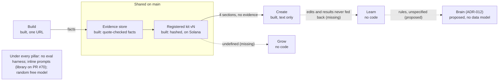

> **Status: active.** Founder and CPO audit of the pitch deck's six pillars against the plans, wireframes, code on main and the live app, done 2026-10-13 for [issue #92](https://github.com/DeveloperAlly/solana-hack/issues/92). Editable copy: [audit doc](https://claude.ai/code/artifact/7ffd1cf0-6720-43d1-b8b3-c7ab6355afd4). Live status stays in [STATE.md](../STATE.md).

# CPO audit: deck vs plan vs build (2026-10-13)

## Task
In the owner's words, 2026-10-13:
- "Audit the complete plans across UI and architecture, act as a founder and CPO of this product: does it match the core value proposition in the deck? Does it, or will it eventually, do what it says?"
- The six pillars: build your brand and voice; create your content; distribute everywhere; verify anywhere (the ledger); grow your reach (ambassadors, influencers, campaigns); learn from what works. An intelligence system runs through Build, Create, Grow and Learn.
- "Think like a founder aiming to launch this vision tomorrow: the complete UI vision. It only needs a very small slice of that to work. Ship, iterate, show the full vision, get users, build features."
- Phases: hackathon critical path (build, full UI, pitch); beta test and validate with real users and foundations; market, with JamJam marketing itself, ship features, get paying users; iterate.

## Verdict

**Not today, and only partly in the plan.** Two of the six pillars (Build and Verify) and the text half of a third (Create) are real code on main. Distribute, Grow and Learn have no backend, only screens with sample data on open PRs. Nothing has run end to end on jamjam.tech: the live database holds 0 brands, kits, posts and sources, and Build is broken live because migration 009 was never applied (see [Pillar detail](#pillar-detail)).

**The intelligence system is the weakest claim.** The deck says one system runs through Build, Create, Grow and Learn. In the code it is a set of separate LLM calls that share an evidence table and the registered kit. Nothing flows back from results or edits, there is no evaluation harness, and the drafting model grades its own voice fit. [ADR-012](https://github.com/DeveloperAlly/solana-hack/pull/86) (proposed) names the missing piece, a Brain, but does not yet define its data, storage or how Learn collects signals.

**Will it eventually do what it says?**
- **Build, Create, Verify:** yes, if the plan is followed. The architecture, backlog and code agree; the gaps are known rows (gap-only interview, voice by example, socials and decks, domain and account verification).
- **Distribute:** planned, but X posting costs money per post ($0.015, $0.20 with a link, [X pricing](https://docs.x.com/x-api/getting-started/pricing)) and Threads needs Meta app review ([Threads](https://developers.facebook.com/docs/threads/get-started)); neither is priced into the $39 "unlimited posts" plan.
- **Grow:** payouts are well specified ([architecture §7.1](../.agentic/what/context/brand_builder_architecture.md)) with zero code; tips and voice licensing are open "to design" issues (#76, #77).
- **Learn:** no. There is no defined loop from outcomes or edits back to the voice or kit, and no data is being collected for it.

**Honestly demo-able on devnet today:** the registry self-test and the Verify read-back code. Once 009 is applied: build a kit from one URL plus the interview, approve three gates, register kit v1 on Solana, draft a text post, approve and register it, check it on Verify by exact text, and see it on the Ledger. Everything else in the deck is wireframes or gallery screens.

## Founder lens: ship the whole vision now

**The complete UI vision is the launch asset, and most of it already exists.** About 83 clickable screens covering all six pillars are built as gallery screens on open PRs (#73: 21, #75: 9, #78: 14, #79: 17, #81: 22), plus Verify and Ledger on `ui/integration` (#68, reaching main through #85). Ship them on jamjam.tech as one product, mark honestly which parts run, and let real clicks decide what gets built next. The audit's job is not to cut the vision but to keep the labels true.

| Pillar | Vision screens built (open PR) | Screens the vision still needs ([ADR-012](https://github.com/DeveloperAlly/solana-hack/pull/86)) |
|---|---|---|
| Front door | Hub-Home (#81) | Today: one approval queue, "step 3 of 6" |
| 01 Build | Journey Main, J1-J8 (#75); Brand Builder, 21 boards (#73) | The Brain: kit, voice, audience, sources, learned rules |
| 02 Create | Content dashboard, Draft-Review, Voice templates and editor (#81); Media composer and review (#79) | Post detail with the six-step lifecycle strip; "Why this?" on every draft |
| 03 Distribute | Publish calendar, Settings-Connections (#79) | Platforms page, publishing queue |
| 04 Verify | Verify 1-5, Ledger (#68, via #85) | Badge embed and badge landing page |
| 05 Grow | Ambassador desktop and mobile, 14 boards (#78); Campaign v2 steps 1-6, Influencer, Partners, Leads, Engage (#79, #81) | Referral, Tips |
| 06 Learn | Analytics, Outcome-Log (#79, #81) | Learned-rule approvals |

**How to launch it:**
1. **One loop nav over the screens.** Put the ADR-012 navigation (Today, Brand, Create, Distribute, Verify, Grow, Learn) over the gallery, so a visitor walks the whole product on jamjam.tech instead of `/screens/<Artboard>`.
2. **Two honest badges on every screen.** "Live" where it runs on devnet (Build, Create text posts, Verify, Ledger); "Preview" where it shows sample data. The deck can then show everything without overclaiming.
3. **Fake doors that count.** Each Preview screen's main button opens "Get early access to <feature>" and stores the email and the feature id. That is demand validation per pillar, ranked by real clicks. Today the GTM draft has no in-product demand signal.
4. **Route every sign-up into the one live slice:** build your kit, write the first post, verify it. That slice is the product; everything around it is the promise.
5. **Build next whatever gets the most early-access requests,** weekly.

**Effort (estimate):** merge the UI PRs and #85; the loop nav and badges, about half a day; the early-access table, one route and one button component, about half a day (one migration). The live slice needs migration 009 applied and one recorded run.

## Scorecard

The deck marks Build and Create BUILT and Verify BUILT · DEVNET; the code supports those labels, but none has run live. Distribute, Grow and Learn are marked NEXT on slide 4, yet slide 3 and the appendix describe parts of them in the present tense.

| Pillar | Deck label (slide 4) | Planned | Designed (wireframes) | Built on main | Proven live |
|---|---|---|---|---|---|
| 01 Build | BUILT | Architecture §2, §5, §6.1; backlog B1-B16 | BB-*, Onboard-*, J1-J5 (gallery on #73, #75) | Partly: one-URL ingest with quote check, 6-step interview, 3 gates, kit registration. No gap analyst, no gap-only interview, no voice by example | No. 0 brands; ingest and answer saves fail until 009 is applied |
| 02 Create | BUILT | §6, §6.1; backlog G1-G4, M1-M3 | Draft-Review, Voice-*, Media-* (gallery on #79, #81) | Text posts: draft from kit, anti-slop check, claims gate at approval, polish with undo, register. No best-of-3, no retrieval, no media | No. 0 posts |
| 03 Distribute | NEXT | Backlog P1-P3a (X, LinkedIn, Bluesky, Threads) | Publish-Calendar, Settings-Connections (gallery on #79) | No. Copy, post yourself, paste the link back. X and LinkedIn are non-runnable stubs | No |
| 04 Verify | BUILT · DEVNET | §7, §7.1; backlog L1-L7 | Verify-1-5, Ledger | Exact-text match: database lookup, then Solana read-back of signer, schema and hash. No link input, no accounts, no domain check | Registry self-test only (synthetic attestation, passes on [issue #4](https://github.com/DeveloperAlly/solana-hack/issues/4)) |
| 05 Grow | NEXT | Payouts (§7.1); tips and x402 are open issues #76, #77 | Amb-*, M-*, Campaign-v2-*, Influencer-* (gallery on #78, #79, #81) | No route, table or migration | No |
| 06 Learn | NEXT | Thin: §6.2 voice ladder, §2 stage 9 "Analyst (later)" | Analytics, Outcome-Log (gallery on #79, #81); no learned-rules screen | No. Edits kept only as a 10-version undo history | No |

Live counts read from the production Supabase project on 2026-10-13 (SELECT only): brands 0, kits 0, posts 0, sources 0, evidence 0, users 1; migrations 001-008 applied, 009 not.

## The intelligence system

**There is no single intelligence system today; there are separate model calls around one shared evidence table and the registered kit.** The code shares three things: the evidence table (with the quote check and [ADR-011](../.agentic/what/decisions/adr_011_evidence_trust.md) trust classes), the registered kit snapshot, and one `chat()` gateway ([llm.ts](../web/worker/llm.ts)). Everything else is seven inline prompts with no versioning, no traces, no retrieval and no measurement.

- The drafter reads four kit sections but never the evidence ([posts.ts L82-83](../web/worker/posts.ts)), so "Kit Facts Only" is a prompt instruction enforced later by the claims gate at approval.
- Grow has no code; its stub drafts from an undefined "campaign voice" ([spec/api/routes/grow.ts L35](../spec/api/routes/grow.ts)) rather than the kit.
- Human edits are stored as a 10-version undo history ([posts.ts L20](../web/worker/posts.ts)) and never read by a model.

**ADR-012 (PR #86) is the right idea but not yet a design.** It makes the Brain the centre of the product and nav, with Learn proposing rules a person approves. It leaves open:
- the data model and where the Brain lives;
- whether learned rules are part of the hashed, registered kit, which changes what a post's proof means;
- where Learn's signals come from, when publishing is copy and paste and yields no metrics;
- the per-draft provenance record that "Why this?" needs;
- how it relates to PR #70's prompt library and workflow engine, which it does not mention.

It also conflicts with ADR-003's navigation and the UI mission's frozen requirement R11, so ratifying it means superseding those.

**Capacity on the free model policy ([ADR-010](../.agentic/what/decisions/adr_010_component_list_and_plan_tiers.md)).** One OpenRouter key serves every user: 20 requests a minute and 50 a day, or 1,000 a day after buying 10 credits ([OpenRouter limits](https://openrouter.ai/docs/api-reference/limits)).

| Unit | Calls today (counted from code) | Calls in the deck's pipeline (estimate) | Platform-wide per day at 1,000 calls |
|---|---|---|---|
| Post | 3-4 | 9-12 | 250-330 today; 85-110 promised |
| Kit v1 | 7-11 | 35-100 | 90-140 today; 10-28 promised |

The 20-requests-a-minute cap is a burst limit, not a concurrency limit. Today a draft is 1-2 calls, but one approval can make up to 8 claims-gate calls when the evidence spans several batches ([posts.ts L332, L369](../web/worker/posts.ts)), so two or three approvals in the same minute reach the cap. In the promised pipeline (9-12 calls a post) the cap allows about two posts a minute across all users. For volume, the daily cap binds first. That fits the founder's own use, not "Solo, unlimited posts" for paying customers. `openrouter/free` also picks a model at random per request ([free router](https://openrouter.ai/docs/guides/routing/routers/free-router)), so the rule that the judge is a different model family from the drafter cannot be guaranteed, and an eval score would not carry over to the next request.

**Biggest structural risk.** The two quality pillars, "sounds like you" and "better with every post", rest on a random free model that grades its own voice fit, with no harness to measure "approved without edit" and no feedback data being collected. Provenance and evidence discipline are well built; they cannot carry a pitch whose first two promises are about output quality.

## Pillar detail

Each deck claim against the code on main (`ea9442f`). Verdicts: **True** (built, matches the words), **Partial**, **Planned only**, **Contradicted** (the repo's own docs or code say otherwise). Nothing below has run live.

### 01 Build
| Deck claim | Verdict | Evidence |
|---|---|---|
| "A fact stays only if its quote is in your source" | True in code | Extract, then keep only facts whose quote is on the page ([api.ts L99-101](../web/worker/api.ts)). Broken live until 009 is applied: `ingest()` inserts `sources.kind` (L85), a column 009 creates |
| "From everything you've published"; "site, socials, docs, decks or repos" | Partial | Main reads one HTML or text URL per call ([ingest.ts L39](../web/worker/ingest.ts)). PR #71 adds site crawl, paste, PDF/DOCX/XLSX and refuses PPTX. Socials are backlog B13 (spec); repos are in no backlog row |
| Three gates: purpose, positioning, voice | True in code | `GATES` ([kit.ts L12](../web/worker/kit.ts)); registration refuses missing gates or stale sections (api.ts L146-173) |
| Gap Analyst and Interviewer "ask only the gaps" | Planned only | Backlog B4 and B5 are spec; the interview is six fixed steps ([steps.ts L17-58](../web/src/screens/build/steps.ts)) |
| "TODAY: you pick your voice by example" | Contradicted | Backlog V1a is "spec, no slice yet". Built: 12 templates on 9 dimensions, which is true |
| Kit v1 registered on Solana | True in code, devnet | `registerKit` with read-back (api.ts L144-231). No real kit exists; JamJam's own kit v1 is not registered |

### 02 Create
| Deck claim | Verdict | Evidence |
|---|---|---|
| "Posts in your voice. You approve each one." | True in code | `draftPost` from the registered kit; `approvePost` is the human gate ([posts.ts L78-105, L394-410](../web/worker/posts.ts)). "Your voice" is a summary of template dials, not your own writing |
| "Claims checked against your evidence, as strictly as you set" | Partial | One LLM verdict on the whole post, at approval only, same model setup as the drafter, recall never measured (posts.ts L345-377). It does block (409) |
| Banned list: 19 phrases, em dashes, hype, rhetorical questions | Partial | Code checks the 19 phrases, the em dash and "!" (posts.ts L27-36); hype and rhetorical questions are prompt-only ([llm.ts L52](../web/worker/llm.ts)) |
| "Any hit forces a rewrite" | Partial | One rewrite attempt; if it fails again the draft is hidden and approval blocked (posts.ts L90-100) |
| Voice draft from "your best approved posts; best of 3" | Contradicted | One prompt, one candidate, no retrieval; [architecture](../.agentic/what/context/brand_builder_architecture.md) §6.1 says so |
| "Every prompt or model change passes the eval gates first" | Contradicted | No `spec/evals/`, no CI eval step ([web-ci.yml](../.github/workflows/web-ci.yml)); backlog X12 is spec |
| Carousels and video (NEXT) | Planned only | Backlog M1-M3; gallery mocks on PR #79 |

### 03 Distribute
| Deck claim | Verdict | Evidence |
|---|---|---|
| "Direct to X, LinkedIn, Bluesky and Threads" (slide 3, present tense) | Planned only | No publishing code for any platform. X and LinkedIn are empty stubs marked "Not runnable code" ([spec/api/lib/clients.ts](../spec/api/lib/clients.ts)); [ADR-008](../.agentic/what/decisions/adr_008_submission_critical_path.md) cuts them until after submission |
| "Copy and paste anywhere else" | True in code | The only distribution path: copy, post yourself, paste the URL back |
| "Only the text you approved goes out" | Not enforced | Nothing fetches the published URL or compares it with the approved text |
| Platform reality | Cost and review gates | X: $0.015 a post, $0.20 with a link, no free tier. LinkedIn Company Pages: vetted API ([LinkedIn Share](https://learn.microsoft.com/en-us/linkedin/consumer/integrations/self-serve/share-on-linkedin) covers member posts only). Threads: Meta app review. Bluesky: free ([rate limits](https://docs.bsky.app/blog/rate-limits-pds-v3)) |

### 04 Verify
| Deck claim | Verdict | Evidence |
|---|---|---|
| "Verify reads Solana before it calls a post official" | True in code, devnet | Database lookup by hash, then Solana read-back of signer, credential, schema and hash (posts.ts L506-537). With no database row it answers "not official" without reading Solana |
| "Paste a post or link" | Partial | Text only; no link input (api.ts L364-365) |
| "Your verified accounts are listed beside it" (present tense) | Planned only | No accounts table or schema; Verify-4 is "Drawn, not built". A verbatim copy from a fake account verifies as Official |
| "Wallets and exchanges can check what's official without asking us" | Unsupported | In no planning doc. The attestation address uses a random nonce ([registry.ts L111](../web/worker/registry.ts)) and `brand_id` is a JamJam UUID, so a third party cannot find it without JamJam's database |
| "Only fingerprints go on-chain" | True, devnet | Five fields: brand_id, hash, kit_version, approver, domain_verified (registry.ts L100) |
| Domain verification | Planned only | Every registration hard-codes `domain_verified: 'false'` (api.ts L223) |

### 05 Grow
| Deck claim | Verdict | Evidence |
|---|---|---|
| Ambassadors, influencers and campaigns write from your kit | Planned only | No route, table or migration. PRs #78, #79, #81 are gallery mocks with `INTEGRATION:` placeholders. The stub drafts from an undefined "campaign voice" |
| Paid in USDC from your wallet, confirmed on-chain | Planned only | Specified in architecture §7.1 and fixture F8; no code |
| "Rewards verified creators instantly" (slide 6 title) | Contradicted | Every payout needs the brand owner to approve and sign (architecture §7.1, [ADR-006](../.agentic/what/decisions/adr_006_wallet_identity_split.md)) |
| Tips, voice licensing (x402), stablecoin plans, 3% take | Planned only | Issues #76 and #77 are open "to design"; tips have no backlog row; 3% is a draft GTM figure (PR #69), ADR-010 sets no prices |
| "Influencers" | Inconsistent term | The deck means people; the backlog and canvas mean the AI persona |

### 06 Learn
| Deck claim | Verdict | Evidence |
|---|---|---|
| "Edits become rules it learns" (A8, present tense) | Contradicted | Architecture §6.1: "edits not learned". Edits are a 10-version undo history (posts.ts L20) |
| "Analytics per platform and voice"; "results feed back into your kit" | Planned only | Backlog N1 (Phase 3) needs publishing APIs first; the only defined loop is architecture §2 stage 9, "Analyst (later)" |
| "NOTHING GRADES ITSELF" with 0 / 0 / 95% hard gates | Contradicted | The drafter scores its own voice fit (posts.ts L82); the wireframe labels it "self-graded today"; no fixtures exist |
| "That data compounds, and it can't be copied" | Unsupported | The "collect from day one" data in architecture §6.2 is not collected; no doc argues it can't be copied |

## Deck claims to change before recording

**Keep every pillar in the deck; fourteen statements need the right label.** Where a fix says "Next", the founder version is "Preview": show the screen, badge it, and point to the early-access count. Judges who open the repo will find the README, STATE.md and architecture docs say the opposite, so these are credibility risks, not polish. Slides as read on 2026-10-13 at 01:55 Melbourne ([deck](https://claude.ai/artifact/4QPRrRAXx8VF4PsKf5qZ8d)).

| # | Slide | Current wording | Problem | Replace with |
|---|---|---|---|---|
| 1 | 3 Solution | "Direct to X, LinkedIn, Bluesky and Threads" (no tag) | No publishing code; slide 4 says NEXT | "Copy and paste today; direct to X, LinkedIn, Bluesky and Threads next" |
| 2 | 3 Solution | "Analytics and your edits feed the next draft" | Nothing learns | "Next: analytics and your edits feed the next draft" |
| 3 | 3 Solution | "Anyone checks a post on the public ledger, so impersonators stand out" | Text match only; no account binding | "Anyone checks a post against what you approved, on Solana" |
| 4 | 4 How it works | BUILD "BUILT", CREATE "BUILT" | Never run live; Build broken live until 009 | Keep BUILT only after one live run is recorded on issue #4 |
| 5 | 4 How it works | "Only the text you approved goes out" | Not enforced | "Verify shows whether the posted text matches what you approved" |
| 6 | 6 Why Solana | "rewards verified creators instantly" | Payouts not built; each needs the brand to sign | "and pays verified creators in USDC" |
| 7 | 6 Why Solana | "checkable by any wallet, exchange or app" | Needs JamJam's database to find an attestation | "recorded on Solana where anyone can check it on jamjam.tech", or build the open index first |
| 8 | 8 Go to market | "Beta Clients: aDNA.network, film.fun, GamersLab & Altumera" | Repo records no agreement or payment (GTM draft, PR #69) | "Design partners (prospects)", or cite what each agreed to |
| 9 | 10 Model | "Solo, unlimited posts, $39" | X charges per post; shared free key caps the platform | "Solo: one brand; paid X posts as an add-on" |
| 10 | A1 Architecture | "Evaluation: every prompt or model change passes the eval gates first"; "Solana Payments" box | No harness; payouts not built | Tag both "Next" |
| 11 | A5 Verification | "Your verified accounts are listed beside it" | Verify-4 drawn, not built | "Next: your verified accounts are listed beside it" |
| 12 | A7 Onboarding | "site, socials, docs, decks or repos"; "Answer only what's missing"; "Pick your voice by example" | One URL on main; interview is fixed; voice is template plus dials | "Add your site and docs"; "Answer six short questions"; "Pick a voice template and tune it" |
| 13 | A8 Pipeline | Gap Analyst, Interviewer, "best of 3", "Edits become rules it learns" | All planned | Mark those four boxes "Next" |
| 14 | A9 Voice ladder | TODAY "pick your voice by example"; "NOTHING GRADES ITSELF" with hard gates | Voice by example not built; the drafter self-grades; no gates run | TODAY: "12 templates on 9 dimensions"; retitle the band "Release gates (planned)" |

**What the deck under-sells.** Built, distinctive and absent from the pitch: evidence trust classes with owner review of third-party facts (ADR-011); refusal to register a kit with a stale section or an unapproved citation; per-section approval; and approval kept separate from on-chain registration. They are the strongest proof that "every fact sourced" is engineering, not copy.

## Plan gaps

**The architecture already specifies most of what the deck promises; the gaps are a missing feedback loop, missing measurement, and three trust claims with no design.** Ranked by risk to the value proposition, then build cost. Effort is an estimate for one agent-assisted builder.

| Rank | Gap | What the plan must add | Risk if left | Effort | Existing row |
|---|---|---|---|---|---|
| 1 | Migrations ship after the code that needs them | Deploy applies pending migrations before the Worker (PR #87), plus a CI check that fails when code references a column no applied migration creates | Live app broken today | Small: owner workflow edit | #87, #38 |
| 2 | No measurement of output quality | Eval harness with fixtures F1-F8 in CI; pin one model per task so the judge is a different family from the drafter | "Sounds like you" cannot be shown | Medium, 2-4 days | X12, X1-X3, G4 |
| 3 | The Brain is a name, not a design | Specify ADR-012 as data: `learned_rules`, a per-draft provenance row (kit version, evidence ids, rule ids, prompt version, model), and whether rules enter the hashed kit | Learn, "Why this?" and Grow have nothing to read or write | Medium: 1 day to spec, 3-5 to build | ADR-012, T1b |
| 4 | Learning data is not collected | Start the architecture §6.2 "collect from day one" list now: all candidates, reject reasons, original and final text, edit diffs | Every later rung of the voice ladder starts from zero | Small-medium | §6.2 |
| 5 | Create bypasses the shared system | Move drafting, polish and the claims check onto PR #70's prompt library and traces; pass the evidence list to the drafter | Two prompt systems; claims blocked late | Small-medium | X4, X5, X14 |
| 6 | Learn has no signal source | Build edit-to-rule first (needs no platform API); analytics only after direct publishing | "Learn from what works" stays two phases away | Medium | T1b, N1, B16 |
| 7 | Grow does not read the kit | One written contract: ambassador drafts use kit vN voice, evidence and approved rules plus the campaign brief | Off-brand ambassador content | Small to spec, large to build | R3, R3a |
| 8 | "Open record" has no design | Derive the attestation address from the post id, as architecture §7.1 already specifies (not from the content hash, which would collide when two brands register the same text); publish an open index from content hash to post id and the normaliser spec, so a wallet or exchange can go from text to attestation without JamJam's database | Slides 6 and 7 claim it | Medium | New row needed |
| 9 | Impersonation claim needs identity | Domain TXT check, account linking (`WL-ACCOUNT`), and Verify that ties a pasted link to its posting account | "Impersonators stand out" is false without it | Medium-large | B15, L3a, L7 |
| 10 | Distribution economics | Price X posting as an add-on; ship Bluesky and LinkedIn member posting first; post-publish check that the live text hashes to the approved text | Margin on "unlimited posts" | Medium per platform | P2, P3, P3a |
| 11 | Shared free key caps the platform | Bring-your-own-key or a paid model budget before selling paid tiers | Two or three approvals in one minute reach the 20-request cap; daily volume tops out at about 85-330 posts platform-wide | Small-medium | S2, ADR-010 |
| 12 | No ratified build order | Ratify or reject ADR-008; ADR-012 conflicts with ADR-003 navigation and R11 | Agents follow whichever doc they read | Owner decision | ADR-008, ADR-012 |

## Launch plan: four phases

The owner's sequence, with what ships and a measurable exit. Exit targets are proposals for the owner to confirm.

| Phase | Goal | What ships | Exit criteria (proposed) |
|---|---|---|---|
| 1. Hackathon critical path (to Oct 13, 5:59pm Melbourne) | Build, full UI, pitch | Migration 009 applied; JamJam's own kit v1 and one post registered and verified live on devnet; the full UI vision on jamjam.tech with loop nav, Live and Preview badges and early-access buttons; deck with the 14 fixes; presentation and demo videos | Kit and post transactions posted on issue #4; every pillar reachable from the nav; 0 deck claims contradicted by the repo; submission filed |
| 2. Beta test and validate (weeks 1-4) | Real users and foundations | Beta brands run the live slice. Foundations: eval harness and pinned models, Brain data spec, day-one data capture, Create on the workflow engine | At least 5 brands with a registered kit; approved-without-edit rate measured; early-access requests ranked by feature |
| 3. Market with itself | JamJam markets JamJam; first paying users | Every JamJam post drafted, approved, registered and verified on JamJam, with a Verify link in each; the most-requested Preview features built first | First paying users; Verify-page visits that convert to sign-ups, measured |
| 4. Iterate | Weekly ship cycle | Next feature chosen each week from early-access counts and usage; Learn loop (edit-to-rule) once data capture has run | One shipped feature a week, each with live proof on its issue |

## For build agents: what this means for open work

| Workstream / PR | Action from this audit |
|---|---|
| Migrations (#87, 009, 010) | Gap 1. 009 must be applied before any further ingest work is tested live; record it as `evidence_trust_009` so #87's runner sees it |
| UI PRs (#73, #75, #78, #79, #81) and #85 | Phase 1: merge-ready first, then one follow-up PR adding the ADR-012 loop nav, a Live or Preview badge on every screen, and early-access buttons (one table, one route, one migration) |
| Pitch (#69) | Apply the 14 deck fixes above; resolve the three owner-decision threads (instantly, beta clients) |
| Workflow engine (#70), source adapters (#71) | Gap 5: after merge, move drafting, polish and the claims check onto the prompt library and traces; pass evidence to the drafter |
| ADR-012 (#86) | Gap 3: add the data spec before any Brain screen is built; note the ADR-003 and R11 conflict; target `main`, not `ui/integration` |
| Intelligence foundations (Phase 2) | Gaps 2, 4: eval harness X12 with pinned per-task models; start day-one data capture on posts |

## Owner decisions

| Decision | Options | Recommendation |
|---|---|---|
| Slide 6 "instantly" | Keep / reword | Reword to "pays verified creators in USDC" |
| "Beta clients" on slide 8 | Keep / "design partners (prospects)" / cite agreements | "Design partners" unless each has agreed in writing |
| Launch prices | $39 Solo, $199 Team, 3% (draft) | Keep $39; make X posting an add-on, not "unlimited" |
| ADR-008 critical path | Ratify / reject | Ratify for the submission window only, so one order binds |
| ADR-012 Brain | Ratify as is / after a data spec | Ratify the direction; require the data spec before any Brain screen is built |
| `OPENROUTER_MODEL` Actions variable | Check its value | Confirm it is unset or `openrouter/free`; two reads of `/api/health` disagreed |

## Method and sources

Read-only audit on 2026-10-13, 01:20 to 02:10 Melbourne. Four agents each read one pillar group or the intelligence system; the deck, ADR-012 and the PRs were read directly, and the live database was checked with SELECT and `list_migrations` only.
- **Deck:** [pitch deck](https://claude.ai/artifact/4QPRrRAXx8VF4PsKf5qZ8d), all 24 slides, changed slides re-read at 01:55 Melbourne.
- **Repo:** `main` at `ea9442f`; branches of open PRs #69, #70, #71, #85, #86, #87; [architecture](../.agentic/what/context/brand_builder_architecture.md), [backlog](../.agentic/how/backlog/backlog.md), [backend map](../.agentic/what/context/backend_map.md), [STATE.md](../STATE.md), ADRs 002, 003, 006, 008, 010, 011 and proposed 012.
- **Wireframes:** [canvas](https://claude.ai/artifact/9aUT9mW2ZHvYsK4SFu1syn) file list plus Verify-1, Verify-4, J1, J7, Onboard-2, Onboard-3, Influencer-Setup, Ledger and the hub boards.
- **Live:** `GET https://jamjam.tech/api/health`; registry self-test comments on [issue #4](https://github.com/DeveloperAlly/solana-hack/issues/4).
- **External:** [OpenRouter limits](https://openrouter.ai/docs/api-reference/limits), [X API pricing](https://docs.x.com/x-api/getting-started/pricing), [LinkedIn Share](https://learn.microsoft.com/en-us/linkedin/consumer/integrations/self-serve/share-on-linkedin), [Threads](https://developers.facebook.com/docs/threads/get-started), [Bluesky rate limits](https://docs.bsky.app/blog/rate-limits-pds-v3), [Cloudflare Browser Rendering pricing](https://developers.cloudflare.com/browser-rendering/pricing/) (10 minutes a day on Workers Free; 10 hours a month then $0.09 an hour on Workers Paid; relevant to PR #71's rendered fallback).

**Not verified:**
- The exact live error when ingest hits the missing `kind` column; it follows from the code and schema, but proving it needs a write.
- The live `OPENROUTER_MODEL` value.
- Whether `openrouter/free` counts toward OpenRouter's `:free` daily caps, and whether the live key has 10 credits.
- The diffs of PRs #79 and #81 (descriptions only) and some artboards (J3-J6, BB-*, Onboard-4-VoicePack).
- Whether a newer canvas version removed the Withdraw button that ADR-006 rules out.
